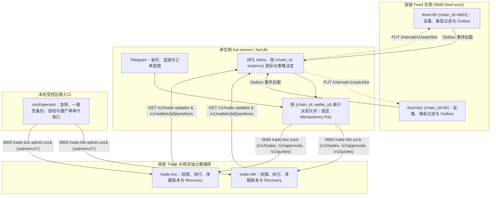

# EVM-Bot 多链交易与跟单系统落地规划文档（审查整合修订版 V3）

> **状态**：`REVISED_PLAN_V3`（已合入 Codex 审查 `BLOCKED` 项修复、`001..050` 真实 Schema 对齐补丁，以及 V3 状态机活性/多链 EVM 计价/跟单产品可用性与低延迟架构优化）；本轮为设计与实施计划修订，不表示代码已实现、测试已通过或已经获得实盘授权。  
> **修订日期**：2026-11-24。  
> **总目标**：将现有 `rbh-bot` 演进为对标 `sol-bot` 产品能力的多链 EVM 低延迟交易与跟单系统（`evm-bot`）。  
> **首期链与 SDK**：Robinhood 主网（API V1 兼容请求串 `"robinhood"`，规范 `chain_slug` 为 `"rbh"`，数字 `chain_id` 为 `4663`）：`github.com/0xfnzero/rbh-trade-sdk`、`github.com/0xfnzero/rbh-parser-sdk`；BSC 主网（规范 `chain_slug` 为 `"bsc"`，数字 `chain_id` 为 `56`）：`github.com/0xfnzero/bsc-trade-sdk-golang`、`github.com/0xfnzero/bsc-parser-sdk-golang`。SDK、ABI、部署地址和解析器能力均按锁定版本验收。  
> **后续链**：Base（`chain_slug="base"`，`chain_id=8453`）、Arbitrum、Ethereum、Monad 等。在已支持的账户类型、交易格式和执行能力范围内通过适配器扩展；新增能力显式升级契约，不承诺任意 EVM 链都仅靠配置接入。

### 修订脉络与阅读说明（V2 Codex 收敛补丁 + V3 深度审查优化）

本文保留总体架构、目标目录和 `Step 0–5 / R0–R9` 引用；通过拆分 **`Step 1A`（RBH 首单正式闭环）**、**`Step 1B`（R6 同钱包连续交易与广播前僵尸单收口）**、**`Step 1.5`（分项多链通用执行能力）** 与 **`Step 2A/2B`**，解除现有 `001..050` SQLite Schema 与实施步骤之间的硬冲突，并补齐生产活性、多链 EVM 细节与低延迟跟单闭环。

| 修订轮次与重点 | 正文位置 | 解决的冲突与优化目标 |
|---|---|---|
| **[V2] 单步单尝试 Schema (`1:1:1:1`) 与 V2 多步/多尝试迁移边界分离** | 1、6.3、6.4、7 | 解决现有 `015..045` 表以 `operation_id` 为唯一主键、触发器禁止同 Operation 多 Step / 多 Attempt / 多 Submission 的硬冲突 |
| **[V2+V3] 沿用 `manualAdmissionContinuation` 同栈执行 + 准入落盘后解耦客户端断连 + 广播前未发单安全终结** | 5.1.2、6.1.3、9.2 | **Codex P1 #1/#5 + V3 P1-1**：重启绝不自动续跑 `ADMITTED` 或从 `signing_intent` 重调 signer；`C3-C` 提交后改用 `context.WithoutCancel` 防止客户端超时制造半成品单；Step 1B 补齐签名前超期 `ABORTED_PRE_SIGN` 与已签未发链上 Nonce 推进核销路径，杜绝单钱包永久锁死 |
| **[V2+V3] 拆分 Step 1A/1B，对齐规范化钱包地址约束，区分双层确认水位与原生币本位可释放未决敞口** | 5.2.1、6.1、7 (Step 1A/1B) | **Codex P1 #2 + V3 P1-3/P1-4**：`051` 预占约束对齐 `(chain_id, lower(wallet_address))` 且允许同钱包多条历史 `frozen` 并存；拆分 `ExecutionContinuityLevel`（秒级放行下一单/卖出）与 `ExposureSettlementLevel`（终局释放原生币本位 `unfinalized_native_outlay_wei`，杜绝 `SELL/Approve` 代币单位混加），解决 L2 买后 15 分钟禁卖与本金周转耗尽问题 |
| **[V2+V3] 首版冻结 `broadcast_unknown`；`UNKNOWN_REPLAY`、SpeedUp/Cancel 与预授权统一归入 Step 2B** | 6.3、6.4、7 (Step 2A/2B) | **Codex P1 #3/#4 + V3**：Step 1A/2A 对 `broadcast_unknown` 只查询对账（`UNKNOWN_REPLAY` 明确保持 `DISABLED`）；BSC 首切片先跑原生币买与已有 allowance / 独立显式 Approve 后卖；预留 `AllowanceModel (NONE / ERC20_DIRECT / PERMIT2)` |
| **[V2+V3] Facts / AAD `v1` 与 `v2` 版本化隔离 + 全局统一数字 `chain_id` 与 `chain_slug`** | 5.1.1、5.3、5.6、6.2 | **Codex P2 + V3 P3-1**：RBH 严格保留 `APPLICATION_TTL_ONLY` 与 `"rbh:4663:...:manual:v1:"` AAD 字节不变；全局 DB 主键、游标与 `AAD v2 ("evm:<chain_id>:...")` 统一使用 `uint64` 数字 `chain_id`，杜绝 `"robinhood"` / `"rbh"` / `4663` 混用 |
| **[V2+V3] OpenAPI `0.5.1` 兼容、双 UDS 权限隔离与本地精简接口矩阵、瞬态繁忙不占幂等键、净经济意图 `trigger_id` 去重** | 2、4.2、5.1、5.3、5.4 | **Codex P1 #6 + V3**：保留 `/v1/trades` 契约且 Step 1A 零新增路由；物理拆分 `trade-<chain>.sock (0660)` 与 `trade-<chain>-admin.sock (0600)`，补齐 `/v1/quotes`、`/v1/approvals`、`/v1/wallets`、`/v1/trade-updates`、`/internal/v1/watchlist` 与受控 `/admin/v1/*`；`409 WALLET_IN_FLIGHT` 不占幂等键；`trigger_id` 按交易级净动作去重 |
| **[V3] 多链 EVM 精确计价、EIP-7702 区块解码兼容、税币净额结算、Multicall3 快照与 SQLite/IPC 生产加固** | 5.2、6.6、Step 0B/2A、9 | **V3 P2-1/P2-2/P2-3/P3-2**：修正 BSC `baseFee=0` 下 Type-2 `tip_gwei` 实际出价与 Gas Floor 校验，接入 Arbitrum `NodeInterface` 拆分 RBH L2/L1 费用；校验 `go-ethereum` 对 `0x04` (EIP-7702) 整块解码；`DecodeEffects` 按钱包真实净收付结算；引入 `Multicall3` 单次快照读取、写连接 `_txlock=immediate`、超时链路不等式与 `VACUUM INTO` 备份规范 |

---

## 1. 核心架构原则与演进策略

1. **先收拢唯一代码基线（R0），再打通闭环，按职责逐步演进**。保留有效迁移与历史执行事实，目录拆分随可验收切片推进；每个切片记录基线 SHA、迁移版本、能力开关和回退边界。
2. **单 Bot 聚合入口，Feed/Trade 按链独立部署与持有数据库**。
   - `bot-service` 独占 `bot.db`：Telegram、钱包公开视图、策略配置、按 `(chain_id, feed_instance_id)` 隔离的持久消费游标、持久 Inbox、按 `(chain_id, wallet_id)` 串行派发的提交任务队列、通知及后续限价单。
   - `feed-service` 每链独占 `feed-<chain_slug>.db` 与 UDS：采集、解析（兼容 EIP-7702 与 L2 交易类型）、观察关联、Outbox、补历史与重组撤回。
   - `trade-service` 每链独占 `trade-<chain_slug>.db` 与 UDS：Admission、钱包权限、执行、风险预占、签名制品、广播及 Recovery。链间不共享 Nonce 分配和写事务；同机部署仍需配置 CPU、磁盘、连接和队列上限，不能把进程拆分等同于全部资源隔离。
3. **全局统一链标识规范**：
   - **`chain_id`（`uint64` 正整数）**：全局数据库主键/外键、游标表、事件契约、`Facts/AAD v2` 一律使用标准 EIP-155 数字 ChainID（如 `4663`、`56`、`8453`）。
   - **`chain_slug`（规范小写短名）**：配置文件、实例名、UDS 路径统一使用规范短名（`"rbh"`、`"bsc"`、`"base"`）。HTTP 边界兼容 V1 请求串 `"robinhood"` 并确定性映射至 `(chain_slug="rbh", chain_id=4663)`，同时保留原始请求串用于 V1 请求指纹计算。
4. **首版与扩展执行模型边界明确**：
   - **V1 执行模型（Step 1A / 1B / 1.5 / 2A）**：遵循现有 `015..050` Schema 的 **`1 Operation = 1 ExecutionStep = 1 TransactionAttempt = 1 Primary Submission`** 约束（每笔 Operation 对应单笔链上交易：原生币买入、已具备足够 allowance 的卖出、或独立发起的单步显式 Approve Operation）。
   - **V2 扩展模型（Step 2B）**：通过以 `step_id / attempt_id / submission_id` 为主键的 additive schema 扩展，再开放单 Operation 内串联 `Approve -> Sell`、同 Step 下 `SpeedUp / Cancel` 替换 Attempt、受控 `UNKNOWN_REPLAY` 及多 Relay 并发 Submission 记录。
5. **双层抽象**：链级连接、费用、广播、Nonce 观察和双层最终性由 `ChainProfile / EVMChainClient` 提供；协议路由、授权模型、报价、无签名构建和净额效果解码由 `ProtocolAdapter` 提供。每个适配器声明能力，未知能力拒绝启用，不跨链或跨协议静默 fallback。
6. **一套权威交易状态机**：`Operation -> ExecutionStep -> TransactionAttempt -> Submission -> Receipt/Canonical/Reorg/Finalized`。Bot 只持有投递与产品视图；权威执行结果、持仓净额和资金账本以 Trade 为准。
7. **SDK 只承担受限能力**：禁止 SDK 隐含签名、发送、分配 Nonce、隐式 Approve 或自动创建替换交易。只读 RPC、纯构建端口与能力测试共同落实边界。
8. **先持久化再产生外部副作用，模糊边界失败关闭（Fail-Closed）且具备可证恢复路径**：受理、执行绑定、Nonce 认领、签名意图（`manual_signing_intents`）、签名制品（`manual_signed_artifact_commands`）、提交基座（`manual_submission_foundations`）、运行时门禁证据与首次广播许可（`FIRST_BROADCAST permit`）在各自事务边界提交后再推进。`manual_signing_intents` 与 `send_intent` 均为不可逆的模糊边界：一旦落盘后崩溃，未确认制品或回执前严禁自动重调 signer 或自动重发；同时区分“签名前可证未签状态”与“签名后需链上 Nonce 越过证明方可核销状态”，防止单钱包永久死锁。
9. **实盘门禁逐链生效**：所有新实例默认 `live_enabled: false`。第 7 章 Step 5 是每条链首次 Live 前的横向门槛；修改本计划不构成执行真实交易或扩大权限的授权。

---

## 2. 总体系统拓扑



每个 Trade 实例对外不暴露任何公网/内网 TCP 业务端口，本机按权限物理拆分为**业务 Socket（`trade-<chain>.sock`，`0660`，供 `bot-service` 调用）**与**管理 Socket（`trade-<chain>-admin.sock`，`0600`，仅属主/`operator` 可连）**。内部依次装配 HTTP/IPC、Application、Execution/Risk、链能力与协议适配器、签名/广播边界和独立 Recovery worker。Recovery 可更新交易事实和账本，但不持有签名器、广播器或 Nonce 分配器。Feed Outbox 与 Trade Updates 均采用单游标至少一次拉取，业务决定和 Trade 受理由持久唯一约束实现幂等。

钱包明文导入通过宿主机受控 `cmd/operator` 直达 Trade/签名侧（绝不经过 Telegram 或 `bot-service`）；限价、止盈止损与 Alpha/Paper 统一接入业务 Socket 的公开准入入口，不绕过 Admission。

---

## 3. 代码现状与基线事实（Step 0 / R0 输入）

| 对象 | 已核对代码库事实 | 修订后的处理原则 |
|---|---|---|
| 当前分支与 `origin/main` | 当前 checkout `ab84f46`（migration 至 `043`）与本地 `origin/main@0f9caf5`（migration 至 `050`）各有 31 / 115 个独有提交；`http-abc-local-integration` 含未提交的 `HTTP_WALLET_REUSE_DESIGN.md` 修改与未跟踪的 `HTTP_WALLET_REUSE_MODEL_PROPOSAL.md` | R0 先固定唯一集成基线 SHA 并**保全所有工作树中的未提交/未跟踪修改**（不把“清理 22 个 worktree”作为 R0 前置条件）；合入 `044–050` 及 A1–A4 有效成果 |
| 正式 HTTP 执行连接 | `worktrees/http-a3-trust-composition/internal/tradeapi/local_post_execution_harness_test.go` 已串起本地首单 harness，但正式 `app.Run` 尚未装配 foundation writer、runtime verifier、first permit issuer 与 submission executor | 在 Step 1A 中将 `binding -> nonce claim -> signing -> submission foundation -> runtime capture -> first permit issue -> atomic permit consume & send` 接入正式 `app` composition |
| 执行所有权与 continuation | `manual_admission_continuation.go` 是单调用栈一次性内存 token（`spent atomic.Bool` + `origin context.Context`）；`033_manual_signing_intent.sql` 禁止删改且不代表可重签许可 | `C3-C` 准入落盘后立即用 `context.WithoutCancel` 解耦客户端断连并施加服务端受控执行时限；重启只对账已落盘状态，绝不从 `ADMITTED` 或 `signing_intent` 重调 signer；Step 1B 补齐广播前僵尸单的安全核销机制 |
| 同钱包连续交易硬锁 | `007` 建有 `one_active_canary_reservation_per_wallet`（`WHERE state IN ('reserved','frozen')`）；`045` 建有触发器 `manual_recovery_no_wallet_reuse` 直接 `RAISE(ABORT, 'MANUAL_WALLET_REUSE_UNSUPPORTED')` | 将 RBH 首单（Step 1A）与同钱包连续交易（Step 1B / R6）拆开；Step 1B 升级索引与触发器至规范化钱包地址维度，支持多条历史 `frozen` 并存及双层确认放行 |
| 单 Operation 表结构约束 | `021..044` 的 `manual_execution_bindings`、`manual_nonce_claims`、`manual_signing_intents`、`manual_signed_artifact_commands`、`manual_submission_foundations`、`manual_first_submission_bindings` 均以 `operation_id` 为 PK/UNIQUE | 首版（Step 1A/1B/1.5/2A）保持 `1 Operation = 1 Step = 1 Attempt = 1 Submission`；多 Step 串联与同 Step 多 Attempt 替换放入 Step 2B 的 V2 表扩展切片 |
| Bot 单消费游标限制 | `internal/bot/store.go` 目前只查 `bot_progress WHERE id=1` 并按单个 `feed_offset` 在 `signal_inbox` 判重 | Step 3A 改为按 `(chain_id, feed_instance_id)` 维护独立游标，分离 `observation_id` 与交易净意图 `trigger_id` |

### 3.1 R0 必须形成的证据与旧库链身份认领规范

- 分支与 worktree 状态清单、未提交/未跟踪改动备份、选定的唯一基线 SHA。
- `043`、`050` 真实历史库的可重复升级样本与迁移校验和；同编号不同 SQL 必须解决，不改写已落地迁移字节。
- 带 `submitted / broadcast_unknown`、签名制品和风险预占的历史数据在升级后仍可恢复。
- **错链数据库防呆与确定性认领（禁止 SQL 迁移内启发式猜测）**：
  - 全新空库：执行迁移后由启动程序根据实例显式配置写入单行不可变身份表 `instance_chain_identity(id=1, chain_id, chain_slug, network_kind)`；
  - 非空历史旧库（尚无 `instance_chain_identity`）：服务启动时直接 Fail-Closed 拒绝运行，必须由运维显式执行一次性命令 `operator db bind-chain --db trade-rbh.db --expected-chain-id 4663`（校验历史迁移谱系及 `rbh:4663:` 制品记录一致后写入身份行），杜绝 SQL 迁移脚本内复杂推断逻辑。
- **底层 EVM 库与四个 SDK 版本锁定**：核验 `go-ethereum` 对 EIP-7702（Type-4 `0x04`）及 Arbitrum Orbit 自定义交易类型的区块解码兼容性；记录四个 SDK 的准确 tag/commit、校验和、部署 ABI、可用方法及副作用隔离清单。

---

## 4. 目标目录结构与依赖规则

### 4.1 演进目标目录结构

保留当前物理路径与 module path 直到基线收拢完成。下列是演进目标，未启用链/协议不提前创建空目录；目录中列出某协议不代表已支持。

```text
evm-bot/                         # 演进期间保留当前物理路径与 module path
├── cmd/
│   ├── trade-service/           # 同一程序，按链/环境分别部署实例 (trade-rbh, trade-bsc...)
│   ├── feed-service/            # 按链/环境分别部署实例 (feed-rbh, feed-bsc...)
│   ├── bot-service/             # Telegram + 跟单 + 限价单（零私钥/零签名依赖）
│   └── operator/                # 运维 CLI：bind-chain、VACUUM 备份恢复、僵尸单审计核销、授权管理
├── api/
│   └── openapi/                 # user-trade-api.openapi.yaml
├── internal/
│   ├── app/                     # composition root、启动、drain；按服务拆分装配函数
│   ├── tradeapi/                # 保留现有 HTTP package 与 manual_* 组件，逐步抽薄
│   ├── application/             # 用例编排和私有 typed handoff
│   ├── trade/                   # 现有核心状态机、execution、recovery、risk store
│   ├── manualartifact/          # 版本化 Facts / AAD (v1 & v2) 与多版本 Keyring 加密验签
│   ├── manualnonce/             # Nonce 观察与校验
│   ├── manualrisk/              # 精确 uint256 风险策略、未决敞口与累计流水计算
│   ├── manualsign/              # 本地内存无副作用签名器封装
│   ├── chains/
│   │   ├── evm/                 # 可复用只读 RPC（Keep-Alive、Multicall3 快照）、交易类型解码与链验证
│   │   ├── robinhood/           # ChainProfile (4663, NodeInterface L2/L1 费用拆分、双层最终性)
│   │   ├── bsc/                 # ChainProfile (56, BEP-226 零 baseFee 计价、Gas Floor、Fast Finality)
│   │   └── base/                # Base 实施阶段创建 (8453, OP Stack L2+L1 data fee)
│   ├── protocols/
│   │   ├── ports/               # ProtocolAdapter 窄接口与纯值类型（含 AllowanceModel / FeeOnTransfer 声明）
│   │   ├── pons/v2curve/        # Robinhood Pons v2 Curve 适配器
│   │   ├── flap/                # Flap 候选适配器（按链与 deployment revision 隔离）
│   │   ├── fourmeme/            # BSC Four.meme 候选适配器
│   │   └── pancakeswap/{v2,v3}/ # BSC PancakeSwap v2 / v3 候选适配器
│   ├── integrations/
│   │   ├── rbhtrade/            # 锁定版本的 rbh-trade-sdk 纯构建/报价封装
│   │   ├── rbhparser/           # 锁定版本的 rbh-parser-sdk 封装
│   │   ├── bsctrade/            # 锁定版本的 bsc-trade-sdk-golang 纯构建/报价封装
│   │   └── bscparser/           # 锁定版本的 bsc-parser-sdk-golang 封装
│   ├── registry/                # chain + protocol + deployment 不可变注册表
│   ├── feed/                    # 观察/动作关联、净经济意图归并、Outbox、补历史与 Reorg 撤回
│   ├── bot/                     # Telegram、按链/实例游标、单钱包串行派发队列、策略与路由缓存
│   ├── storage/                 # SQLite WAL（_txlock=immediate、写单连接+读池、迁移、Retention）
│   ├── ipc/                     # UDS HTTP、HMAC 鉴权（先验签后写有界防重放缓存）、RequestID
│   ├── health/                  # 活性探测防覆盖 Socket、Readiness 三权门禁、Buffered Metrics
│   └── observability/           # 结构化日志、分阶段延迟/队列/WAL 页数/恢复指标
├── configs/
│   ├── chains/                  # rbh.yaml, bsc.yaml
│   └── policies/
└── tests/
    ├── fixtures/                # 各链真实脱敏 RPC / ABI / Receipt / EIP-7702 区块样本
    ├── contract/                # ProtocolAdapter 统一契约测试套件
    └── integration/             # 正式 HTTP 入口 + 本地受控 RPC 端到端验收
```

### 4.2 严格依赖方向与能力边界

| 调用方 | 允许依赖 | 不允许持有或调用 |
|---|---|---|
| `cmd/trade-service -> internal/app` | HTTP、Application、Registry、Trade/Execution、Risk、Recovery、Storage 的装配 | 在 HTTP handler 内另写第二套独立账本状态机 |
| `application / tradeapi` | 用例编排、权限、预算、同栈 `manualAdmissionContinuation` 推进 | 绕过执行记录直接调用 SDK 高层交易方法，或凭公开 `request_id` 重建已销毁的 continuation |
| `protocols/<proto>`、`integrations/<sdk>` | `protocols/ports` 纯值类型、受限只读 RPC、ABI 与构建器 | 私钥、signer、broadcaster、Nonce allocator、DB 写句柄、隐藏网络写入 |
| `recovery` | 历史绑定、只读链查询、`DecodeEffects`、受 fence 保护的状态和账本写入 | signer、broadcaster、发送 permits、Nonce allocator |
| `bot-service` | 自有 `bot.db`、`feed-<chain>.sock`（Outbox 拉取与 `/internal/v1/watchlist`）、`trade-<chain>.sock`（`/v1/trades`、`/v1/approvals`、`/v1/quotes`、`/v1/wallets`、`/v1/trade-updates`） | Trade/Feed 数据库直读直写、`trade-<chain>-admin.sock`、钱包明文私钥、链签名、任何绕过 Admission 的内部裸签/裸发路由 |
| `feed-service` | 自有 `feed.db`、数据源、解析器、受控 Watchlist 过滤状态 | 创建交易、使用交易钱包私钥或修改 Trade 风险记录 |
| `cmd/operator` | 离线空库/停机库维护（如 `bind-chain`），或运行期通过 `0600` `trade-<chain>-admin.sock` 调用受控管理接口 | 在 `trade-service` 运行期间从进程外直接打开 `trade.db` 抢写锁或热拷贝裸 `.db / -wal` 文件 |

---

## 5. 核心接口与多链数据契约

### 5.1 用户与本地 UDS 接口契约（OpenAPI `0.5.1` 兼容、V2 扩展与双 Socket 隔离）

#### 5.1.1 核心交易路由与请求结构
为保证现有 `internal/tradeapi/http.go` 的 `strictObject` 解析器、`docs/user-trade-api.openapi.yaml`（`0.5.1`）及 C 线契约测试 100% 兼容，**Step 1A / 1B 零新增业务接口，严格保留现有 V1 请求/响应契约与路由路径**：
- 下单：`POST /v1/trades`（必填 Header：`Authorization: Bearer <token>`、`Idempotency-Key: <id>`）
- 按请求 ID 查询：`GET /v1/trades/{request_id}`（返回 `Location: /v1/trades/{request_id}` 指向的 `TradeRecord`，内含关联的 `operation_id`）
- 按幂等键找回：`GET /v1/trades/by-idempotency-key?idempotency_key=...`
- 审计事件流：`GET /v1/trades/{request_id}/events?after=...`

**V1 现行请求结构（Step 1A / 1B 直接使用，金额与比例均为十进制字符串，`ttl_seconds` 为正整数）**：
```json
{
  "chain": "robinhood",
  "wallet_id": "wallet-01",
  "token": "0x2000000000000000000000000000000000000002",
  "side": "buy",
  "amount": "0.01",
  "slippage_percent": "3",
  "ttl_seconds": 60,
  "fee": { "max_gwei": "3", "tip_gwei": "0.2", "max_total_native": "0.001" }
}
```

> [!IMPORTANT]
> **V2 请求契约扩展与幂等键占用边界（Step 1.5 / Step 2A 启用，记录 `request_schema_version = 2`）**：
> 1. 在 `strictObject` 中向后兼容新增可选字段 `"protocol"`（如 `"auto"`、`"pons-v2-curve"`、`"four-meme"`、`"pancake-v2"`）以及与 `"amount"` 互斥的精确原子单位字段 `"amount_raw"`（`uint256` 十进制整数字符串，彻底消除清仓卖出时的精度尾差或向上舍入越界）。
> 2. `chain` 字段按实例注册表严格校验（RBH 实例接受 `"robinhood"` 及 V2 别名 `"rbh"` 并统一映射 `chain_id=4663`；BSC 实例仅接受 `"bsc"` 映射 `chain_id=56`；严禁跨链 fallback）。旧请求仍按落盘时的 `request_schema_version = 1` 与原始字段计算 `request_fingerprint`。
> 3. **瞬态繁忙不消费 `Idempotency-Key`（Step 1B / Step 3A）**：当新 `Idempotency-Key` 在准入前遇到**同钱包存在在途未决世代（`409 WALLET_IN_FLIGHT`）**或**上游只读 RPC/数据库锁瞬态不可用（`503 TRANSIENT_UNAVAILABLE`）**时，响应体显式携带 `"retryable": true`，且**不将该 `Idempotency-Key` 写入终态拒绝记录、不扣减授权额度**，确保 `bot-service` 在前序订单确认后使用同一固定 `Idempotency-Key` 重试时可正常准入。确定性业务拒绝（参数非法、风控超上限、钱包处于 `frozen` 审计锁定态等）则标记 `"retryable": false`。

#### 5.1.2 首次 Admission 同栈一次性 Handoff、客户端断连解耦与超时不等式
- **首期执行所有权模型（Step 1A / 1B / 2A）**：
  - `POST /v1/trades` 完成身份鉴权、严格 JSON 校验、幂等查重、只读链上验证（C2）和原子准入（C3-C）后，**仅首次 durable admission 胜出的那一个调用栈**获得私有的、不可序列化的 `manualAdmissionContinuation`（`spent atomic.Bool`）。
- **准入落盘后与客户端 Socket 断连解耦及在途等待句柄（`inFlightWaitCh`）**：
  - 一旦 `C3-C` 事务提交落盘，continuation 内部立即切换为服务端受控上下文 `execCtx = WithDeadline(context.WithoutCancel(reqCtx), min(now + local_exec_budget, expires_at))` 并监听进程 `graceful_drain_ctx`，同时在进程内注册按 `operation_id` 索引的只读完成等待通道 `inFlightWaitCh`。
  - 若上游客户端因短暂超时断连后立即使用同一 `Idempotency-Key` 重试 `POST /v1/trades`（或调用 `GET /v1/trades/{request_id}`）且命中仍在内存执行中的 continuation，服务端优先等待 `inFlightWaitCh` 完成（或返回 `"continuation_active": true`），避免调用方将正在推进的订单误判为已崩溃死单。
  - 在该胜出调用栈内，按固定顺序同步推进以下持久阶段：
    1. `manualExecutionBindingWriter.bind`（写入 `manual_execution_bindings`）
    2. `manualNonceClaimWriter.claim`（写入 `manual_nonce_claims` 与 `transaction_attempts`）
    3. `manualLocalSigningWriter.sign`（先写入 `manual_signing_intents` 模糊边界，立即复核 writer fence，调用本地内存无副作用 signer，解码验签后写入 `manual_signed_artifact_commands`）
    4. `manualSubmissionFoundationWriter.write`（从 `manual_submission_foundation_expected` 视图派生并写入 `manual_submission_foundations`）
    5. `manualRuntimeVerifier.capture`（采集当前 runtime clock/control/auth/lease/gate 证据写入 `manual_runtime_gate_snapshots`）
    6. `manualFirstBroadcastIssuer.issue`（签发 `FIRST_BROADCAST` one-shot `canary_send_permits`）
    7. `manualSubmissionExecutor.execute`（在同一 SQLite 事务中原子写入 `manual_first_submission_bindings`、消费 permit、创建 `transaction_submissions(state='submitting')`，随后落盘 `send_intent_at`，调用 exact-byte transport 广播并记录 `submitted / broadcast_unknown / known_unsent`）
- **超时链路硬约束**：配置校验强制要求 `bot_http_client_timeout > trade_http_write_timeout > (pre_send_rpc_budget + broadcast_rpc_timeout + 2s)`，保证广播超时进入 `broadcast_unknown` 时，`trade-service` 能向调用方返回完整的结构化 `202` 状态响应而非直接掐断 UDS 连接报 `EOF`。
- **崩溃与重启边界**：进程在 `ADMITTED` 后、进入 `submitting` 前若因断电/OOM 崩溃，一次性 continuation 立即销毁；**重启或重复 POST 绝不凭历史 `ADMITTED` 或 `manual_signing_intents` 自动续跑未完成步骤或重调 signer**；广播前遗留记录按 6.1.3 的可证安全核销协议处理。

#### 5.1.3 本地 UDS 双通道物理隔离与精简接口全景表
在不暴露任何业务 TCP 端口、不引入外部消息中间件（沿用同机延迟 `~0.1ms` 的 UDS + HTTP Keep-Alive）且严守“每库单进程独占写连接”的前提下，本机通信按权限物理拆分为两类 Unix Domain Socket，并随实施切片按需补齐以下 6 类精简本地接口：

- **业务通道**：`trade-<chain_slug>.sock` 与 `feed-<chain_slug>.sock`（文件权限 `0660`，属组仅含 `bot-service`），携带应用级鉴权与有界防重放。
- **管理通道**：`trade-<chain_slug>-admin.sock`（文件权限 `0600`，仅实例属主 / 本机受控 `cmd/operator` 可访问，对 `bot-service` 物理不可见），确保运行期急停、在线一致性备份与审计核销均由 `trade-service` 自身单写连接安全串行执行，彻底消除外部进程写库争锁。

| 所属 Socket（权限） | 方法与路由 | 核心职责与副作用边界 | 引入切片 |
|---|---|---|---|
| `trade-<chain>.sock` (`0660`) | `POST /v1/quotes` | **纯只读路由解析 + 预报价 + Allowance/Gas 预检**：复用 `Resolve + Quote + Multicall3` 快照支撑 TG 代币卡片与限价/止盈止损巡检；**零写库、零预占、不在 `bot-service` 重复耦合各链 SDK** | Step 1.5 / 2A |
| `trade-<chain>.sock` (`0660`) | `POST /v1/approvals`<br>`GET /v1/approvals/{request_id}`<br>`GET /v1/approvals/by-idempotency-key` | **独立显式单步 ERC-20 `Approve` 及对称查单路由**：请求仅传 `protocol + token + amount_raw`（**严禁直传外部 `spender`**，强制从注册表派生并校验 `EXTCODEHASH`）；配备对称按 ID / 幂等键查单接口防丢响应且不污染 `/v1/trades` 的 `TradeRecord`；**风控仅计入原生币 Gas 支出与 `operation_count`，绝不把代币额度混入原生币敞口** | Step 1.5-C |
| `trade-<chain>.sock` (`0660`) | `GET /v1/wallets` & `GET /v1/wallets/{wallet_id}/positions` | **钱包公开状态与精确原子持仓查询**：返回公开地址、钱包状态（`ready / in_flight / frozen`）及精确 `uint256` 字符串 `native_balance_raw / token_balance_raw / allowance_raw / decimals / has_unfinalized_buy`，支撑零尾差按比例清仓 | Step 1.5-C |
| `trade-<chain>.sock` (`0660`) | `GET /v1/trade-updates?after_seq=...` | **基于追加事件序号的增量状态流**：直接投影自全局追加表 `trade_audit_events(event_seq INTEGER PRIMARY KEY AUTOINCREMENT)`，载荷携带 `"operation_kind": "trade" \| "approval"` 以统一驱动单钱包队列放行；当游标过期被清理或越界时显式返回 **`410 Gone (CURSOR_OUT_OF_RANGE)`** 触发逐单对账重置，严禁静默跳号 | Step 3A |
| `feed-<chain>.sock` (`0660`) | `PUT /internal/v1/watchlist` | **持久化动态关注目标同步（采集降噪）**：由 `bot-service` 推送带 `watchlist_version` 的活跃 `Watched Wallets + 持仓/挂单 Token` 集合；**`feed-<chain>` 将其持久化至本地 `feed-<chain>.db`**（重启直接从本地库恢复过滤集，首次建库 `version==0` 前暂停扫块，杜绝重启窗口漏单），过滤 BSC 全链 **99%+** 无关 Swap | Step 3A |
| `trade-<chain>-admin.sock` (`0600`) | `POST /admin/v1/control/emergency-stop`（及 `/resume`）<br>`POST /admin/v1/backup`<br>`GET /admin/v1/diagnostics/stuck`<br>`POST /admin/v1/operations/{id}/abort-pre-sign` | **本机受控不停机运维**：毫秒级原子落盘并翻转内存急停门禁；进程内协调写连接执行 `VACUUM INTO` 一致性快照；只读诊断卡单详情并对满足 6.1.3 条件的签名前超期单执行受审计收口 | Step 0B (`stop`) / Step 1B (`abort`) / Step 5 (`backup`) |

> [!WARNING]
> **本地接口“三不加”安全红线**：
> 1. **绝不新增绕过 Admission 的内部裸签/裸发接口**（如 `/internal/sign`、`/internal/send-raw`）；手动单、跟单、限价单与 Approve 全部受统一准入、风控预占与 Permit 约束。
> 2. **绝不在 `bot-service` 或业务 Socket 暴露私钥导入接口**；钱包明文导入仅限宿主机受控 `cmd/operator`（离线初始化或仅属主可连的 `0600` 管理通道 + 内存清零）。
> 3. **Step 1A 保持“零新增业务接口”**，直接基于现有 `POST /v1/trades` 与 `GET /v1/trades/{request_id}` 完成 RBH 首单闭环验收。

### 5.2 `ChainProfile` 与 `ProtocolAdapter` 双层契约

#### 5.2.1 链身份、交易格式与双层最终性能力
`ChainProfile` 定义 `chain_id`、`chain_slug`、主网/测试网环境、genesis/checkpoint、原生币与 Wrapped 地址、RPC 身份验证和各项能力。`profile_revision`、部署版本与历史绑定一同持久化；升级策略不能改写历史交易的解释方式。

| 能力 | 必须描述的内容 |
|---|---|
| `AccountCapabilities` | 首版交易钱包仅支持常规纯 EOA（`eth_getCode == empty`）；签名前检查实际账户代码，拒绝带 `0xef0100...`（EIP-7702 委托）或合约代码的交易钱包；同时底层区块/回执读取器必须完整支持解码链上他人发出的 EIP-7702（Type-4 `0x04`）及 L2 系统交易 |
| `TxEnvelopeCapabilities` | Legacy (`0x00`)、Type-2 (`0x02` EIP-1559) 等发送信封格式，独立于链上实际费用计价算法 |
| `FeePolicy` | 有效 Gas 计价公式、节点最低 Gas Floor、L2 执行费与 L1 数据费拆分方式、风险预算上界计算公式 |
| `OrderingPolicy` | 公共交易池、Sequencer 先到先服务等排序模型；费用变化是否影响排序 |
| `ReplacementPolicy` | 首版（Step 1A/1B/2A）固定为 `DISABLED`（含 `UNKNOWN_REPLAY` 关闭）；Step 2B 按链与 Relay 能力显式配置 |
| `FinalityPolicy` | **显式拆分为两级阈值**：① `ExecutionContinuityLevel`（允许推进同钱包下一 Nonce 及卖出已购入 Token 的 canonical 纳入条件）；② `ExposureSettlementLevel`（允许释放原生币本位未决重整敞口 `unfinalized_native_outlay_wei` 并确认账本不可逆的终局条件） |
| `RPCReadCapabilities` | `Multicall3` 地址与可用性、`safe/finalized`、EIP-1898 支持度、顺序模拟能力；启动时验证所需能力 |
| `SubmissionPolicy` | `public` / `private_only` / `private_then_public` 传输范围、超时后的 `broadcast_unknown` 冻结语义 |

#### 5.2.2 首期链计价差异与精确费用预算（防止拒单失真与 Out-of-Gas）
- **RBH（`chain_id=4663`，Arbitrum Orbit L2）**：
  - ETH 为 Gas 资产，Sequencer 先到先排序。Arbitrum Nitro 的 `eth_estimateGas` 会将 L1 数据费按当前 L2 baseFee 折算进返回的总 Gas Limit：
    $$\text{estimatedGas} = G_{\text{L2}} + \frac{\text{L1DataFeeWei}}{P_{\text{L2BaseFee}}}$$
  - 若直接用 $\text{estimatedGas} \times P_{\text{userMaxFee}}$ 计算原生币预占，当用户 `max_gwei` 远高于当前极低的 $P_{\text{L2BaseFee}}$ 时，L1 数据费部分会被凭空放大数十至数百倍导致误拒单；而若签名前 $P_{\text{L2BaseFee}}$ 小幅上升又会导致折算的 $\Delta G$ 缩水触发链上 `out of gas`。
  - **处理规则**：`chains/robinhood` 优先调用 Arbitrum 标准预编译 `NodeInterface (0x00000000000000000000000000000000000000C8)` 的 `gasEstimateComponents` 拆分 $G_{\text{L2}}$ 与 $\text{L1DataFeeWei}$，分别施加独立安全余量计算 tx `gasLimit` 与原生币风险预占上界（当节点不支持预编译时回退保守总估算模式并记录标记）。`ExecutionContinuityLevel` 为 Sequencer canonical 区块纳入并复核区块头连续；`ExposureSettlementLevel` 为 L1 确认对应的 `safe/finalized` 高度。
- **BSC（`chain_id=56`）**：
  - 官方客户端 `EffectiveGasPriceForBSC`（BEP-226）以 `baseFee = 0` 计算有效价格；对于 Type-2 (`0x02`) 交易：
    $$\text{effectiveGasPrice} = \min(\text{maxFeePerGas},\ \text{maxPriorityFeePerGas})$$
  - **处理规则**：在 BSC 上，`tip_gwei`（`maxPriorityFeePerGas`）直接决定实际出价上限而非“基础费之上的小费”。`chains/bsc` 必须校验最终有效出价不低于验证者动态最低门槛（如 `0.05 ~ 0.1 gwei` 及节点 `eth_gasPrice` 下限），并明确 `{max_gwei, tip_gwei}` 到 Legacy / Type-2 字段的映射规则，防止高 `max_gwei`、低 `tip_gwei` 交易被节点以 `transaction underpriced` 拒绝。`ExecutionContinuityLevel` 优先采用 BSC Fast Finality（BEP-126 `safe/finalized` 约 2~3 块，不支持时回退配置块深）；`ExposureSettlementLevel` 采用 `finalized` 或保守确认深度。
- **Base（`chain_id=8453`，Step 4 扩展）**：OP Stack L2，通过 `GasPriceOracle` 独立计算并预占 `L2 execution fee + L1 data fee` 上界。

#### 5.2.3 广播隐私与多 Relay 混合结果语义
- **首版单主通道 exact-byte 传输（Step 1A / 1B / 2A）**：每次 `FIRST_BROADCAST` permit 消费对应单次确定性 exact-byte 传输调用；`private_only` 模式下严禁在超时或失败时静默回退到公共 RPC。
- **多 Relay 并发广播（Step 2B 扩展）**：向多个 Relay 并发推送同一已签名原字节（同一 `tx_hash`）时，整体广播状态采取最保守合并规则：任一成功/`already known` 记为 `submitted`；若 Relay A 超时/断连而 Relay B 明确拒绝，整体**仍必须记为 `broadcast_unknown`**（绝不判为 `known_unsent`），保留 Nonce Lane 与风险预占冻结直至链上对账明确。

#### 5.2.4 `ProtocolAdapter` 窄接口与税币/授权声明

| 方法 | 输入 | 输出 | 约束 |
|---|---|---|---|
| `Describe` | 锁定的 adapter revision | chain/side/pool phase/quote asset、账户类型、`AllowanceModel`（`NONE` / `ERC20_DIRECT` / `PERMIT2`）、`FeeOnTransferSupport`、`DeadlineCapability`（`APPLICATION_TTL_ONLY` vs `CONTRACT_DEADLINE_UNIX`） | 纯元数据，能力描述随版本冻结 |
| `Resolve` | 链配置、Token、受限只读快照、可选缓存 hint | 验证过的受信协议合约（factory/pool/router/curve/spender）身份、runtime codeHash（及已知代理槽位实现地址）、部署版本与池阶段 | 不信任调用方传入的 codeHash，不发送交易 |
| `Quote` | 已解析路由、原子整数输入、一致状态快照 | expected output、费用/税费组成、最低净到账输出 `minOut`、报价区块锚点 | 不预占风险、不分配 Nonce、不发 Approve |
| `BuildUnsigned` | 已验证冻结参数（金额、recipient、`minOut`、route revision、可选派生 `contract_deadline`） | 无签名 `to/value/calldata`、实际 spender、语义摘要 | **不签名、不发送、不暗中发 Approve、不写 DB** |
| `DecodeEffects` | 原绑定身份、已验证 Receipt/Logs | **以钱包地址真实净收付变化为准**的标准化成交效果及证据完整性标记 | 纯只读解码；对含转账税（Fee-on-Transfer）代币必须按接收地址实际 `Transfer` 净增量结算持仓，禁止直接采信池子毛输出导致账本虚高 |

#### 5.2.5 SDK 能力矩阵与适配器准入
在 R0 / Step 2A 锁定 commit 后核验下表。未经源码与固定样本核验的能力一律标为 `UNVERIFIED` 并默认关闭：

| SDK / 协议范围 | 锁定版本 | Resolve | Quote | 纯 BuildUnsigned | Receipt Decode | 必须隔离的 SDK 副作用入口 | 准入计划 |
|---|---|---|---|---|---|---|---|
| `rbh-trade-sdk` / Pons v2 Curve | `v0.4.0` (已锁定) | 已实现 | 已实现 | 已实现 (`pons` adapter) | 已实现 | 不使用任何带 signer/send 的高层封装 | **Step 1A 首发闭环** |
| `rbh-parser-sdk` / Pons v2 Curve | `v0.4.0` (已锁定) | Registry 快照恢复 | 不适用 | 不适用 | Receipt & Sequencer 解析 | Sequencer `OnSequence` 不作持久位点 | **已接入 `feed-service`** |
| `bsc-trade-sdk-golang` / Four.meme 或 Flap 曲线 | Step 2A 锁定 commit | 待核验 | 待核验 | 核验 `FourBuilder` 等纯构建方法 | 待核验净额解码 | 严禁注入 SDK `Signer` / `NonceManager` / `Submitter` | **Step 2A 选定单一已核验协议/阶段** |
| `bsc-trade-sdk-golang` / PancakeSwap V2/V3 | Step 2A 锁定 commit | 待核验 | 待核验 | 核验 `PancakeBuilder`、FeeOnTransfer 路由与 `deadline` | 待核验净额解码 | 严禁调用隐式 `Approve` 或自动发送；V3 核清是否依赖 `Permit2` | 视 `deadline` (Step 1.5) 验收后在 Step 2A/2B 启用 |
| `bsc-parser-sdk-golang` | Step 3A 锁定 commit | 待核验 | 不适用 | 不适用 | 待核验（含 EIP-7702 兼容） | 网络 WS/RPC 采集与游标由 `feed-bsc` 负责 | **Step 3A 接入** |

### 5.3 标准化观察与成交事件契约（`NormalizedSwapEvent` v2）

为同时解决“同一笔 Swap 经 mempool/sequencer 与 receipt 两路到达重复触发”以及**“被跟单地址使用聚合路由在一笔交易内跨多池拆单（如 Pancake V2 + V3）导致双倍跟单”**，Feed 事件严格分离三层身份：

| 身份字段 | 生成规则 | 用途与去重边界 |
|---|---|---|
| `observation_id` | `chain_id : feed_instance_id : source : tx_hash : source_seq_or_log_index : stage` | 单次观察记录唯一 ID；用于 `feed_events` 与 Bot `signal_inbox` 的**消息级投递幂等** |
| `trigger_id` | `chain_id : tx_hash : lower(trader_address) : lower(token_address) : side`（**不含 `source`、不含 `block_hash`、不含具体子池 `protocol`**） | 同一笔链上交易内目标交易员对同一目标 Token 的**跨来源、跨分仓统一净经济动作 ID**；无论先从 mempool 还是后从 receipt 到达，也无论聚合器拆成几个子池成交，同一笔交易最多只生成一个跟单意图 |
| `inclusion_id` | `chain_id : block_hash : tx_hash : lower(trader_address) : lower(token_address) : side` | 具体某个区块中的净成交事实；用于观察统计在 Reorg 时的撤回与重算 |

- **真实交易员（Trader）归因与默认触发阶段**：解析器同时支持常规 Router 调用与被跟单地址通过 EIP-7702 自调用/聚合器发起的 Swap（结合 `tx.from` 与目标资金流归因，避免误把 Router 当成 Trader）。首版（Step 3A）默认仅对经确认的 `included`（Receipt）事件生成跟单任务；`intent` 阶段仅预热路由缓存。

### 5.4 Feed → Bot → Trade 的按链独立游标、串行派发与新鲜度

1. **Bot 按 `(chain_id, feed_instance_id)` 维护独立消费游标**：
   - 废弃单行 `bot_progress WHERE id=1`，升级为 `bot_feed_cursors(chain_id, feed_instance_id, durable_event_offset, updated_at, PRIMARY KEY(chain_id, feed_instance_id))`；`signal_inbox` 唯一键升级为 `(chain_id, feed_instance_id, feed_offset)` 与 `(chain_id, observation_id)`。
   - `feed-rbh (chain_id=4663)` 与 `feed-bsc (chain_id=56)` 同时发送 `offset = 1` 时各自独立推进，互不干扰。
2. **经济动作去重、固定 `Idempotency-Key` 与单钱包串行派发队列**：
   - 跟单决定表 `copy_signal_decisions` 以 `(principal_id, strategy_id, chain_id, trigger_id, action_kind)` 为 `UNIQUE` 约束，落盘时生成不可变的 `trade_idempotency_key = sha256(decision_id + wallet_id)`。
   - `bot-service` 内部按 `(chain_id, wallet_id)` 维护单并发派发通道：当前一笔跟单请求已返回 `202` 尚未到达 `ExecutionContinuityLevel` 时，后续待发任务在本地队列等待前单确认（或因超出 `max_signal_age_ms` 直接标记 `EXPIRED_SKIPPED`），若偶发收到 `409 WALLET_IN_FLIGHT (retryable=true)` 则退避重试并**保持原 `trade_idempotency_key` 不变**。
3. **瞬态容错与信号新鲜度（`max_signal_age_ms`）**：
   - 拉取 Feed Outbox 遇到瞬态错误时采用带抖动的指数退避；恢复连接后若 `now - first_observed_at > max_signal_age_ms`，仅推进游标并记录 `EXPIRED_SKIPPED`，严禁集中补买过期历史信号。

### 5.5 路由缓存、Multicall3 快照核验与失效

- `bot-service` 与 `trade-service` 维护的路由缓存仅作为 `Resolve` 的候选 hint。
- **区分受信协议合约与非受信目标 Token**：`runtime_code_hash`（及已知代理实现槽位）锁定用于核验**受信协议合约（router / factory / curve / spender）**未被篡改升级；对于非受信的目标 ERC-20 Token，不假定 `codeHash` 不变即无作恶（存储变量仍可能动态调税或拉黑），核心防线在于**一致快照模拟 + 钱包净到账 `minOut` 硬保护 + Step 4 顺序买卖模拟**。

### 5.6 多版本密钥环与 Facts/AAD 版本隔离

- **多版本密钥环（Keyring）**：`AESGCMCipher` 支持 `active_key_version`（新制品加密）与 `historical_keys map[string]cipher.AEAD`（按制品 `key_version` 解密历史制品）。
- **Facts 与 AAD 版本严格隔离（`v1` vs `v2`）**：
  - **`v1`（现有 RBH / Pons v2 Curve 冻结格式）**：一字不改保留 `internal/manualartifact/identity.go` 与 `033_manual_signing_intent.sql` 的 JSON 字段顺序、`deadline_capability="APPLICATION_TTL_ONLY"`、`contract_deadline=false` 及 AAD 字节 `"rbh:4663:" + f.OperationID + ":" + f.ExecutionStepID + ":" + f.AttemptID + ":manual:v1:" + digest`，确保历史库与旧密文 100% 可恢复。
  - **`v2`（Step 1.5 / Step 2A 引入的多链与受控 Deadline 格式）**：当 `chain_id != 4663` 或协议声明 `CONTRACT_DEADLINE_UNIX` 时，启用 `Facts.Version = 2` 及十进制数字 `chain_id` 前缀的 `AAD v2`（`"evm:" + strconv.FormatUint(chainID, 10) + ":" + f.OperationID + ":" + f.ExecutionStepID + ":" + f.AttemptID + ":manual:v2:" + digest`）。Recovery 按落盘 `artifact_version` 分派验证器。

---

## 6. 交易执行、风险守恒与恢复机制

### 6.1 同钱包连续交易、双层确认水位与广播前僵尸单收口

#### 6.1.1 Step 1A：保持单钱包单单硬约束，最快交付 RBH 正式首单闭环
- Step 1A **不修改** `007` 的 `one_active_canary_reservation_per_wallet` 唯一索引，也**不删除** `045` 的 `manual_recovery_no_wallet_reuse` 触发器；同钱包第二单继续按 `MANUAL_WALLET_REUSE_UNSUPPORTED` 拒绝，专注打通首单正式装配与重启恢复。

#### 6.1.2 Step 1B（R6）：对齐规范化地址、双层确认水位与可释放未决敞口
在 Step 1A 验收后，Step 1B 通过 additive migration（`051+`）落地既满足跨代 Reorg 风险守恒、又支撑低延迟连续交易与跟单周转的模型：

1. **规范化钱包地址唯一性与预占索引升级**：
   - 在钱包注册表强制 `(chain_id, lower(wallet_address))` 唯一（防止同地址多 `wallet_id` 别名绕过锁）。
   - 将 `007` 的 `one_active_canary_reservation_per_wallet` 升级为**仅限制同一 `(chain_id, lower(wallet_address))` 最多存在 1 条活跃 `state = 'reserved'` 预占**，而**允许同一钱包同时存在多条历史 `state = 'frozen'` 记录**（确保即便连续两代已 `settled` 订单在同一次多区块 Reorg 中同时回退为 `frozen`，也绝不会触发 SQLite 唯一索引冲突）。
2. **双层确认水位放行（解决二层网络买后 15 分钟无法卖出问题）**：
   - **下一代准入条件（`ExecutionContinuityLevel`）**：当前钱包不存在任何未决世代（`reserved / signing / signed / submitting / submitted / broadcast_unknown / orphaned / reconciling`）且不存在任何 `state = 'frozen'` 的待核查重整世代；前序世代已达该链 `ExecutionContinuityLevel`（如 RBH Sequencer canonical 纳入、BSC Fast Finality），且最新一致快照核实前序 canonical receipts 仍在链上、`confirmed_nonce == pending_nonce == expected_next_nonce`。
   - **因果顺序下的卖出放行**：由于 EVM 严格保证 `Nonce N`（前序 BUY）先于 `Nonce N+1`（后续 SELL）执行，在前序 BUY 达到 `ExecutionContinuityLevel` 且链上确认钱包已持有目标 Token 后，**允许立即准入同 Token 的 SELL 订单**（无需苦等 15 分钟的 L1 Finality）；SELL 订单独立预占其自身最大原生币 Gas 支出，即便遭遇极端 Reorg 最坏情况也仅是链上 Revert 消耗该笔已预占 Gas，绝无裸空穿仓风险（Canary 严格测试期仍可通过策略开关 `sell_requires_buy_finality` 切换保守模式）。
3. **拆分“原生币本位未终局在途支出”与“Canary 累计总流水”（严格统一量纲）**：
   - **`unfinalized_native_outlay_wei`（原生币本位未决重整敞口，终局自动回血）**：仅按**链原生币原子单位（wei）**汇总该钱包所有尚未达到 `ExposureSettlementLevel`（`finalized`）世代的最大原生币在途支出——其中 `BUY` 计入 `native_value_wei + max_native_gas_wei`，**`SELL` 与 `APPROVE`（`tx.value == 0`）仅计入各自的 `max_native_gas_wei`（严禁将 ERC-20 代币卖出数量或授权额度与原生币相加，也不引入易被操纵的即时币价折算）**，受 `max_wallet_unfinalized_native_outlay` 与最大未终局笔数 `max_wallet_unfinalized_ops` 双重约束；`SELL` 代币数量由链上已核实持仓余额硬约束。一旦某历史世代达到 `ExposureSettlementLevel` 且处于稳定 `settled` 态，其占用的 `unfinalized_native_outlay_wei` 自动释放。
   - **`cumulative_canary_turnover`（Canary 阶段授权硬顶）**：单调递增不退回，按原生币投入与总操作次数分别受 `canary_authorization_usage` 及运维策略控制。

#### 6.1.3 广播前崩溃/超期未发单的可证安全终结协议（防止单钱包永久锁死）
针对进程在 `submitting` 前意外崩溃遗留的记录，在 Step 1B 中按是否跨越 `manual_signing_intents` 模糊边界严格区分处理：

| 遗留阶段 | 数据库可证事实 | 安全终结与解冻规则 |
|---|---|---|
| **签名前中断**（停在 `ADMITTED` / `binding` / `nonce_claim`，**无 `manual_signing_intents` 记录**） | 事务级证明从未调用过 signer，世上不存在对应签名交易字节 | 当 `now > expires_at + skew_grace`、**当前进程内存无该 `operation_id` 的活跃 continuation** 且只读链上复核 `confirmed_nonce == pending_nonce` 未变时，允许写入不可变 `manual_pre_send_aborts` 记录，将预占迁至 `aborted_pre_sign`（释放活跃 `reserved` 槽位，已扣减的 lifetime 授权次数不退回）。**SQLite 触发器双向互斥**：`manual_signing_intents` 的 `BEFORE INSERT` 强制校验不存在 `manual_pre_send_aborts`，反之亦然，从数据库层彻底封死慢速协程苏醒竞态 |
| **签名模糊态或已签未发**（存在 `manual_signing_intents` 或 `manual_signed_artifact_commands`，但无 `send_intent`） | 已跨越签名意图边界；坚持 Fail-Closed **绝不重调 signer、绝不凭超时自动释放 Nonce Lane** | 保持钱包自动冻结并告警；唯有当**链上已终局确认 `finalized_nonce > claim.nonce` 且原 `tx_hash` 未上链**（例如通过 Step 2B 受控同 Nonce `0` 值自转 `Cancel` 交易或外部受控消费该 Nonce 后达终局），EVM 协议层数学证明该 `claim.nonce` 旧签名永远无法再生效时，方可经 `operator` 审计归档解冻 |

### 6.2 受控 Contract Deadline 与订单过期

1. **RBH / Pons v2 Curve 保持 `APPLICATION_TTL_ONLY`**：使用 `Facts v1 / AAD v1`（`contract_deadline = false`），保持历史兼容性。
2. **新协议受控 `CONTRACT_DEADLINE_UNIX`（Step 1.5 / Step 2A）**：仅对声明 `CONTRACT_DEADLINE_UNIX` 的适配器，由不可变 `expires_at` 确定性派生 `contract_deadline = expires_at.Unix()` 并写入 `Facts v2 / AAD v2`。
3. **过期不释放已广播责任**：`now >= expires_at` 仅阻断尚未进入 signer 或尚未消费 `FIRST_BROADCAST` permit 的操作；一旦进入 `submitting / send_intent / submitted / broadcast_unknown`，Nonce Lane 与风险预占持续保留直至链上终局对账完成。

### 6.3 ERC-20 Approve 显式生命周期与授权模型声明

1. **阶段 A（Step 1.5-C / Step 2A）：只读 Allowance 门禁 + 独立显式 `POST /v1/approvals`**
   - `ProtocolAdapter.Describe()` 显式声明 `AllowanceModel`（`NONE` / `ERC20_DIRECT` / `PERMIT2`）。Step 2A 首发协议仅启用 `NONE`（原生币买）与 `ERC20_DIRECT`（标准 ERC-20 授权卖）。
   - 卖单在准入前检查受信 spender 的当前 `allowance >= required_amount`；不足时直接返回 `ALLOWANCE_INSUFFICIENT`（附带 `token`、`protocol`、`spender`、`current_allowance_raw`、`required_amount_raw`），**绝不在买单后自动发 Approve，也不在 Sell 内隐式夹带 Approve**。
   - **注册表派生 `spender`、对称查单与风险计量单位隔离**：`POST /v1/approvals` 请求仅接受 `protocol + token + amount_raw`（拒绝直传任意外部 `spender`，强制由 `ProtocolAdapter.Resolve` 从注册表派生并校验 `EXTCODEHASH`），并配齐对称只读路由 `GET /v1/approvals/{request_id}` 与 `GET /v1/approvals/by-idempotency-key` 处理丢响应恢复；风控仅预占该笔 Approve 的**最大原生币 Gas 支出（计入 `unfinalized_native_outlay_wei`）**并扣减 `operation_count`，**绝不将代币授权额度累加进原生币计价字段**；`DecodeEffects` 兼容无返回值的非标准 `approve` ABI。
2. **阶段 B（Step 2B 进阶切片）：单 Operation 多 Step 串联、`Permit2` 与策略级买后预授权**
   - 在完成 V2 多 Step 表结构扩展后，开放单 Operation 内 `Approve -> Sell` 自动串联、`Permit2` 双层过期校验及策略显式开启的买后预授权。

### 6.4 `broadcast_unknown` 冻结与 Step 2B 重播/替换边界

1. **Step 1A / 1B / 2A：`broadcast_unknown` 严格保持冻结（`UNKNOWN_REPLAY = DISABLED`、`Replacement = DISABLED`）**
   - 广播超时、断连或多通道结果不明时记为 `broadcast_unknown`，严禁重签、严禁提价替换、严禁释放 Nonce Lane 与风险预占，仅由后台唯一 Recovery worker 持续执行只读 `tx / receipt / nonce` 查询对账。
2. **Step 2B：受控原字节重播（`UNKNOWN_REPLAY`）与同 Nonce 提价替换（`SpeedUp / Cancel`）**
   - 原字节重播在 Step 2B 启用时，必须先执行只读 `tx/receipt/nonce query-first`、通过 runtime verifier 门禁、签发并原子消费独立的 one-shot `UNKNOWN_REPLAY` permit，且仅重推原 `SignedArtifact` 解密校验后的 exact raw bytes。
   - 同 Nonce `SpeedUp / Cancel`（含用于核销签名模糊态的同 Nonce `0` 值自转 Cancel）统一在 Step 2B 的 V2 多 Attempt 表结构完成后启用，并在终局前追踪同一 Nonce 下所有候选 `tx_hash`。

### 6.5 原子风险预算与资产净额账本

- 全部金额与 Gas 采用精确 `uint256` 整数运算（`internal/manualrisk/units.go` 与 SQLite `manual_u256_*`），零浮点数。
- 原生币支出上界按 `ChainProfile.FeePolicy` 精确覆盖 `tx.value + L2ExecutionGasBound + L1DataFeeBound`（防漏计与防 Nitro 双重放大）。
- 持仓账本以 `DecodeEffects` 解码的**钱包地址真实净收付增量**为准，天然兼容税币（Fee-on-Transfer）与滑点差异。

### 6.6 `Multicall3` + JSON-RPC Batch 同节点快照读取与动态区块水位防滞后

- **Step 1A** 沿用现有 `chainquery.Client` 的 `begin / finish` 区块锚定模式，确保首单快速闭环。
- **Step 1.5 / Step 2A** 引入 **`Multicall3` 快照 + Nonce 同批次 JSON-RPC Batch 读取** 与 **动态 canonical 区块水位校验**：
  1. 将 `[eth_call(Multicall3, "latest"), eth_getTransactionCount(wallet, "latest"), eth_getTransactionCount(wallet, "pending")]` 封装进**单次 HTTP JSON-RPC Batch 请求**发送，确保在负载均衡反向代理下落在同一台后端节点，并在单次 `Multicall3` 执行上下文内原子返回 `blockNumber`、`blockHash`、原生币余额、Token 余额、`allowance`、受信协议合约 `EXTCODEHASH` 与池子储备/报价（准入前 RPC 降至 **1 次 HTTP 往返**，且消除跨节点 EIP-1898 `unknown block` 报错）；
  2. **动态区块水位防滞后（兼容 Reorg 回落）**：实时取该钱包当前处于 `canonical` 态世代的 **`required_block = MAX(inclusion_block_number)`**（不做死板的只增不减持久化，若某世代因 Reorg 回退为 `orphaned` 或迁入更低块高的更重分叉，水位自动随真实 canonical 记录调整）；若 `/positions`、`/quotes` 或秒级卖出 `POST /v1/trades` 读到的节点返回 `snapshot.blockNumber < required_block`，直接返回 **`503 RPC_STATE_LAGGING (retryable=true)`（不消费 `Idempotency-Key`）**，绝不因命中落后节点而误判“余额不足”永久拒单。

### 6.7 单 Owner、Fence、暂停与无 Signer 恢复模式

- `SUBMISSION` 与 `RECOVERY` 使用独立的 `canary_worker_leases(role, environment, holder_id, lease_epoch, expires_at)`，所有状态迁移在 SQLite 写事务内强制校验 `holder_id + lease_epoch` fence。
- 支持不注入私钥启动 `trade-service`（对外提供 `/v1/` 只读查询，内部运行唯一 `RECOVERY` worker 持续对账在途交易，进程内存与依赖图中零 signer / broadcaster）。

---

## 7. 分阶段实施路线图（Step 0 ~ Step 5）

```text
Step 0A/0B (R0 基线固定 + 保全 worktree + operator bind-chain + SQLite/IPC/EIP-7702 底座加固)
  ├──> Step 1A (R1-R5: RBH 正式 HTTP 首单闭环 + ctx 断连解耦 + Recovery 重启验收，单钱包单单)
  │      ├──> Step 1B (R6: 051 规范化钱包地址迁移 + 双层确认放行 + 可释放未决敞口 + 签名前超期收口)
  │      └──> Step 1.5 (统一数字 chain_id + Facts/AAD v2 + Deadline + 独立 Approve + Multicall3 + 精确持仓 API)
  │             └──> Step 2A (R7: BSC 首协议单阶段独立实例闭环 + 零 baseFee 计价 + unknown 冻结对账)
  │                    ├──> Step 3A/3B (按链独立游标 + 净意图 trigger_id + 单钱包串行跟单队列 + TG + Retention)
  │                    └──> Step 2B / Step 4 (V2 多 Step/Attempt、UNKNOWN_REPLAY、SpeedUp/Cancel、Permit2、事务合并与 Base)
  └──> Step 5 (R9: 每条链独立执行的 VACUUM 加密备份恢复、Preflight 与 Canary 实盘授权关口)
```

| 交付切片 | 依赖 | 独立交付结果 | 关键收敛与优化亮点 |
|---|---|---|---|
| **Step 0A / 0B（R0）** | 现有分支与 worktree | 唯一基线 SHA（保全 worktree 修改）、`operator bind-chain`、`043/050` 升级验证、SQLite/IPC/超时/EIP-7702 底座加固 | 写连接 `_txlock=immediate`、防重放先验签后入缓存、固化超时链路不等式 |
| **Step 1A（RBH 正式首单闭环）** | Step 0 | 正式 `app` 经 UDS 完成一次 `POST /v1/trades` 到本地受控传输，重开 SQLite 可查可恢复 | `C3-C` 后 `context.WithoutCancel` 解耦客户端断连；不绑架 R6、不改 `1:1:1:1` Schema |
| **Step 1B（R6 同钱包连续交易与僵尸单收口）** | Step 1A | 升级 `007/045` 对齐规范化钱包地址，支持多条历史 `frozen`、双层确认放行、终局释放未决敞口及签名前超期 `ABORTED_PRE_SIGN` | 彻底解决二层买后 15 分钟禁卖、本金周转耗尽与广播前断连永久锁死钱包三大痛点 |
| **Step 1.5（多链通用执行底座）** | Step 1A | 统一数字 `chain_id`、`Facts/AAD v2`、受控 `contract_deadline`、独立显式 Approve、`Multicall3` 快照、`GET /v1/wallets/{id}/positions` 与税币净额结算 | 消除跨节点 EIP-1898 `unknown block`，打通精确清仓卖出与多链密文隔离 |
| **Step 2A（R7 BSC 首协议最小闭环）** | Step 1A + Step 1.5（同钱包连续买卖回归含 Step 1B） | `trade-bsc` 独立实例与 DB，跑通首个已核验 BSC 协议买卖闭环、`baseFee=0` 精确计价与 `broadcast_unknown` 冻结对账 | `UNKNOWN_REPLAY` 与 `SpeedUp/Cancel` 明确保持 `DISABLED`，边界极简可控 |
| **Step 2B（V2 多步/多尝试与低延迟进阶）** | Step 2A + Step 1B | V2 多 Step/Attempt 表扩展、`Approve->Sell` 串联、`Permit2`、`UNKNOWN_REPLAY`、同 Nonce `SpeedUp/Cancel`、多 Relay 广播及**发送前相邻纯内部 SQLite 事务合并** | 将单笔本地 `FULL fsync` 从 ~10 次压减至 3~4 次，并提供签名模糊态链上 Cancel 核销工具 |
| **Step 3A / 3B（多链 Feed + Bot 跟单 + TG）** | Step 1B + Step 2A | `(chain_id, instance)` 独立游标、净意图 `trigger_id`、`409 WALLET_IN_FLIGHT` 非消费幂等重试 + Bot 单钱包串行派发队列、TG 多链交互与 Retention | 彻底解决双链 `offset=1` 冲突、聚合器拆单双倍跟单及串行锁永久缓存拒绝 |
| **Step 4（R8 高级策略与 Base 扩展）** | Step 2A + Step 3A | 限价单/止盈止损、顺序买卖防貔貅模拟（`eth_simulateV1`）、Alpha Paper/Shadow、Base 链接入 | 统一复用准入与权限边界 |
| **Step 5（R9 生产验收与 Canary 授权）** | 对应链最小闭环通过 | `VACUUM INTO` 在线一致性加密备份异机恢复、无发送 Preflight、Emergency Stop/Drain、受限 Canary 授权 | 横向门禁，RBH 与 BSC 可各自独立进入 Step 5 |

### Step 0（R0）：基线收拢与 P0 工程底座加固

#### Step 0A：保全工作树、固定唯一集成基线与确定性链身份绑定
1. **保全所有 Worktree 修改**：盘点当前 checkout `ab84f46`、`origin/main@0f9caf5` 及全部 worktree（尤其是 `http-a3-trust-composition` 与 `http-abc-local-integration`），备份未提交/未跟踪文件后建立唯一集成基准分支并记录完整 SHA 对照表。
2. **统一无 Signer 查询 + 同库唯一 Recovery 启动模式**：未注入私钥时对外提供 `/v1/` 只读查询并自动运行持有 `RECOVERY` lease 的唯一后台恢复 worker。
3. **历史库升级与 `operator db bind-chain` 错链防护**：验证 `043 -> 050+` 历史库无损升级；空库按实例配置自动初始化 `instance_chain_identity`，非空无身份旧库必须经 `operator db bind-chain --expected-chain-id 4663` 核验落盘后方可启动。
4. **底层交易类型解码核验**：验证锁定的 `go-ethereum` 版本可无报错解码含 EIP-7702（`0x04`）及 Arbitrum Orbit 特殊交易类型的完整区块与回执。

#### Step 0B：P0 工程底座加固
1. **优雅关闭（Graceful Drain）**：用 `errgroup / WaitGroup` 统一管理 HTTP server、Feed runner、Bot consumer/dispatcher 与 Trade recovery worker，确保所有在途同栈 continuation 与后台协程退出后再关闭 SQLite 与 RPC 连接。
2. **SQLite 连接初始化、`_txlock=immediate` 与 WAL 膨胀治理**：
   - 写连接采用单连接池并强制 DSN 带 `_txlock=immediate`（确保读写升级事务在 `BEGIN IMMEDIATE` 阶段受 `busy_timeout(5000)` 保护，杜绝 `BEGIN DEFERRED` 直接抛 `SQLITE_BUSY`）；
   - 只读查询采用受控短超时读连接池；每条新建连接读回校验 `journal_mode=wal`、`synchronous=FULL`、`foreign_keys=1`，设置 `PRAGMA journal_size_limit = 67108864`（64MB），并在 `/metrics` 暴露 WAL 页数指标防长读阻塞 Checkpoint。
3. **双 UDS 隔离、IPC 抗 DoS、活性 Socket 保护与超时链路对齐**：
   - 物理分离业务 `trade-<chain>.sock`（`0660`）与本机运维 `trade-<chain>-admin.sock`（`0600`，承载 `/admin/v1/control/emergency-stop` 等不停机运维接口）；
   - 修复 `ipc.Authenticator.Verify` 对空 Body 的处理；**严格先执行 HMAC 验签与窄时间窗校验（本机 UDS 默认 `±30s`），验证通过后才检查并写入按调用方隔离的有界 `a.seen` 缓存**（满载拒绝且绝不淘汰窗内有效 nonce，同时防止未授权垃圾请求打满缓存）；
   - `health.Server` 与各 UDS Server 启动前先探测 Unix Socket 是否有活进程监听，防止误删运行中实例的 Socket；
   - 补齐 HTTP `ReadTimeout / WriteTimeout / IdleTimeout` 并强制校验 `bot_timeout > trade_write_timeout > rpc_budget` 不等式；`/metrics` 改为 `bytes.Buffer` 缓冲写入；`chainquery.Client` 开启 HTTP Keep-Alive 连接池复用。
4. **多版本 Keyring**：扩展 `AESGCMCipher` 支持活跃加密密钥版本 + 历史解密密钥环，100% 兼容现有 `v1` 密文。

### Step 1A（R1~R5）：RBH 正式 HTTP 首单闭环与 Recovery 验收

**目标**：在不触碰 R6 多代钱包复用、不改变 `001..050` 单步 Schema 的前提下，将现有 MANUAL 私有组件正式接入 `app` 生产装配，跑通从一次 `POST /v1/trades` 到本地受控传输及重启恢复的完整闭环。

1. **抽离 `ChainProfile` 与 `ProtocolAdapter` 窄接口（R1/R2）**：封装 RBH Pons v2 Curve 的 `Describe / Resolve / Quote / BuildUnsigned / DecodeEffects`（并预置 Arbitrum `NodeInterface` 费用拆分接口支持）；Recovery 仅注入只读 `DecodeEffects`；保持 calldata、金额单位、`APPLICATION_TTL_ONLY` 与 `Facts/AAD v1` 字节完全不变。
2. **正式装配 MANUAL 首单完整连接点与客户端断连解耦（R3）**：
   - 连接 `POST /v1/trades` 首次 durable admission 胜出者的私有 `manualAdmissionContinuation`；`C3-C` 提交后立即切换为 `context.WithoutCancel(reqCtx)` + 服务端受控执行超时；
   - 严格按序走完：`manualExecutionBindingWriter -> manualNonceClaimWriter -> manualLocalSigningWriter -> manualSubmissionFoundationWriter -> manualRuntimeVerifier.capture -> manualFirstBroadcastIssuer.issue -> manualSubmissionExecutor.execute`。
3. **失败关闭边界**：进程在 `ADMITTED / signing_intent` 崩溃重启或收到重复 POST，绝不重建 continuation、绝不重调 signer、绝不重发；客户端通过 `GET /v1/trades/by-idempotency-key` 或 `GET /v1/trades/{request_id}` 找回原单；`UNKNOWN_REPLAY` 在本阶段保持 `DISABLED`。
4. **重启 Recovery 与生命周期验收（R4/R5）**：真正关闭并重开 SQLite 数据库（含无 signer 模式），验收 Receipt 确认、Revert、Canonical mismatch、Reorg（`canonical -> orphan -> canonical`）及 `RECOVERY` lease takeover。

**Step 1A 可验收出口**：正式 UDS 入口单次 `POST /v1/trades` 跑通全链路，重开 SQLite 后查询与对账完整；`controlled_signer_calls=1`、`controlled_transport_calls=1`、`real_mainnet_sends=0`、`duplicate_actions=0`；同钱包第二单明确返回 `MANUAL_WALLET_REUSE_UNSUPPORTED`。

### Step 1B（R6）：同钱包连续交易、双层确认放行与签名前僵尸单收口

**依赖**：Step 1A 通过（设计与单元测试可从 R1 后并行开展）。

1. **规范化钱包地址与 `051` 预占/触发器迁移**：强制钱包表 `(chain_id, lower(wallet_address))` 唯一；升级 `007` 唯一索引为仅限制同钱包地址最多 1 条活跃 `state = 'reserved'`，允许同钱包多条历史 `state = 'frozen'` 并存；升级 `045` 触发器支持前序世代全部达 `ExecutionContinuityLevel` 且链上观察连续时放行下一代。
2. **双层确认水位与原生币可释放未决敞口落地**：实现 `ExecutionContinuityLevel`（放行下一 Nonce 及同 Token 卖出）与 `ExposureSettlementLevel`（达终局自动释放原生币本位 `unfinalized_native_outlay_wei`），并与单调累计的 `cumulative_canary_turnover` 分离校验；对瞬态在途冲突返回不消费 `Idempotency-Key` 的 `409 WALLET_IN_FLIGHT (retryable=true)`。
3. **广播前未发单安全终结落地**：按 6.1.3 落地签名前超期记录向 `aborted_pre_sign` 的核验迁移及 `cmd/operator` 审计状态查看工具。

**Step 1B 可验收出口**：覆盖“连续两代已 `settled` -> 第 3 代在途 -> 2 块 Reorg 使前两代同时回退 `frozen`”零唯一索引冲突、L2 买后达 `ExecutionContinuityLevel` 秒级卖出（大额代币卖单不误触原生币敞口上限）、终局后 `unfinalized_native_outlay_wei` 准确释放、以及签名前超期记录安全收口释放钱包锁。

### Step 1.5：面向多链的通用执行底座

| 子切片 | 实施内容 | 验收出口 |
|---|---|---|
| **1.5-A：数字 `chain_id` 统一与 `Facts/AAD v2` 解耦** | 升级 `015..050` 中写死 `4663` 的约束为绑定 `instance_chain_identity.chain_id`；保留 RBH `v1` AAD，新增 `"evm:<chain_id>:...:manual:v2:"` | RBH 旧库与 `v1` 密文 100% 恢复；错链 DB 启动前拒绝 |
| **1.5-B：受控 `CONTRACT_DEADLINE_UNIX` 与税币净额结算** | 对声明 `CONTRACT_DEADLINE_UNIX` 的适配器派生固定 `contract_deadline`；`DecodeEffects` 强制按钱包真实 `Transfer` 净收付增量更新持仓 | 超期/重启下 Facts v2 哈希恒定；税币买入后持仓与链上真实余额精确到 1 wei 一致 |
| **1.5-C：Allowance 门禁、`/v1/approvals` 对称路由与持仓/预报价 API** | 卖单准入校验 `allowance >= required_amount`；落地 `POST /v1/approvals` 及对称 `GET /v1/approvals/{id}`、`/by-idempotency-key`；落地 `POST /v1/quotes`、`GET /v1/wallets` & `/positions` 及下单字段 `amount_raw` | `/v1/quotes` 零写库零预占；Approve 丢响应可按幂等键找回、独立结算；`amount_raw` 清仓零尾差 |
| **1.5-D：`Multicall3` + Nonce 同批次 JSON-RPC Batch 快照** | 将 `Multicall3` 状态/报价读取与 `latest/pending` Nonce 合并进单次 HTTP JSON-RPC Batch，并接入动态 `MAX(inclusion_block_number)` 水位校验 | 准入前同节点单次 HTTP 往返，消除跨节点 `unknown block` 与落后节点误拒单 |

### Step 2（R7）：BSC 接入与 V2 多步/多尝试扩展

#### Step 2A：BSC 首个协议、单一池阶段的最小闭环
1. **锁定 `bsc-trade-sdk-golang` 版本并输出能力与副作用隔离表**；选定单一已核验协议阶段（原生币买 + 已有 allowance 或独立显式 Approve 后卖）。
2. **实现 `chains/bsc` Profile**：`chain_id=56`、BEP-226 `baseFee=0` 下 Type-2 `tip_gwei` 有效计价与验证者最低 Gas Floor 校验、BSC Fast Finality 双层确认、`private_only` 严禁回退公共池。
3. **`broadcast_unknown` 保持冻结**：只做 Recovery 查询对账，`UNKNOWN_REPLAY` 与 `SpeedUp/Cancel` 保持 `DISABLED`。
4. **独立实例验收**：同机并行运行 `trade-rbh` 与 `trade-bsc`，通过正式 HTTP 首单、独立 Approve、卖出（含税币净额与 `amount_raw` 清仓；合入 Step 1B 后完成同钱包 `Buy -> Approve -> Sell` 连续交易）及重启恢复验收。

#### Step 2B：V2 多 Step/Attempt 扩展、受控重播/替换与事务合并优化
1. **V2 多 Step / 多 Attempt Schema 扩展**：支持单 Operation 内 `Approve(0) -> Approve(amount) -> Sell`、`Permit2` 授权校验、策略显式买后预授权、带 `query-first + UNKNOWN_REPLAY permit` 的原字节重播、同 Nonce `SpeedUp / Cancel`（含用于核销签名模糊态的同 Nonce `0` 值自转 Cancel）及多 Relay 并发广播。
2. **发送前纯内部事务合并（低延迟优化）**：在不改变任何外部副作用前持久化不变量的前提下，将 `signed_artifact` 落盘后至 `send_intent` 前无外部 IO 的相邻内部 SQL 步骤合并进共享写事务，将单笔订单本地 `FULL fsync` 次数从 ~10 次压减至 3~4 次。
3. **扩展更多 BSC 协议与毕业 DEX 路由（PancakeSwap V2/V3）**。

### Step 3：多链 Feed 与 Bot 持久跟单闭环、Telegram 产品完善

#### Step 3A：按链独立游标、净经济意图去重与单钱包串行跟单闭环
1. **升级 `bot.db` 按 `(chain_id, feed_instance_id)` 独立消费游标**，实现 `observation_id`（投递幂等）与净经济动作 `trigger_id = chain_id : tx_hash : trader : token : side`（跨源、跨聚合器分仓去重）两级幂等。
2. **接入 `feed-rbh` 与 `feed-bsc` 并启用持久化动态 Watchlist 降噪**：兼容 EIP-7702 交易员归因，默认仅对 `Stage == included` 触发跟单；通过 `PUT /internal/v1/watchlist` 将活跃关注钱包与持仓/挂单 Token 同步并**持久化至 `feed-<chain>.db`**（重启直接从本地库恢复过滤集），过滤 BSC 海量无关区块噪音。
3. **按 `(chain_id, wallet_id)` 串行派发队列 + 固定 `Idempotency-Key` + 基于 `event_seq` 的增量状态流**：
   - 本地串行派发等待前单达 `ExecutionContinuityLevel`（通过投影自 `trade_audit_events(event_seq)` 的 `GET /v1/trade-updates?after_seq=...` 单游标增量拉取全部状态跃迁，驱动队列放行与 TG 通知）；偶发 `409 WALLET_IN_FLIGHT` 或 `503 RPC_STATE_LAGGING` (`retryable=true`) 退避后复用原 `Idempotency-Key` 重试；
   - 跟单卖出通过 `GET /v1/wallets/{id}/positions` 读取 `token_balance_raw` 计算精确 `amount_raw` 下单；超 `max_signal_age_ms` 信号标记 `EXPIRED_SKIPPED` 不补单。

**Step 3A 可验收出口**：① 双链同时发 `offset = 1` 互不干扰；② 同一笔 Swap 经 mempool+receipt 两路到达、或聚合器拆成 V2+V3 两池成交，均只生成 **1 个** 跟单意图与 **1 个** `Idempotency-Key`；③ 连续两笔快频跟单在串行锁下有序成交，零永久缓存拒绝、零重复下单。

#### Step 3B：完整 Telegram 多链交互、策略管理与数据 Retention
- 完成 Telegram 白名单、显式选链、钱包公开持仓视图、手动快速买卖（支持按精确比例清仓）、跟单策略配置、成交通知及基于“最小消费者游标水位 + Reorg 窗口”的定时 Retention。

### Step 4（R8）：高级策略能力与 Base 链扩展
- 限价单与止盈止损、基于 `eth_simulateV1` / 状态覆盖的顺序买卖防貔貅模拟、Alpha Paper/Shadow（默认关闭）及 Base（`chain_id=8453`，含 OP Stack L1 Data Fee）标准接入。

### Step 5（R9）：按链独立执行的生产验收与 Canary 实盘授权关口
- 每条链完成最小闭环后即可独立进入 Step 5：① 锁定版本/配置/钱包/限额；② 基于 `VACUUM INTO` / `sqlite3_backup` 的加密快照与异机无 signer 恢复对账演练；③ 无发送 Preflight、Readiness、Emergency Stop 与 Graceful Drain 演练；④ 独立审查并签发受限 runtime Canary 授权（默认始终 `NOT_GRANTED`、`live_enabled = false`）。

---

## 8. 后续新增 EVM 链 / 协议的标准 5 步清单

1. **定身份、能力与真实样本**：核实数字 `chain_id`、`chain_slug`、genesis/checkpoint、费用公式（L2/L1 拆分、最低 Gas Floor）、双层 Finality 能力及交易信封类型（含 `0x04` / L2 系统交易）；录入真实区块、ABI、calldata 与税币/常规币 Receipt 样本；锁定 SDK commit 并输出副作用隔离表。
2. **加 `ChainProfile`**：在 `internal/chains/<chain_slug>/` 实现链身份校验、精确费用上界、`Multicall3` 快照读取与广播传输策略。
3. **写 `ProtocolAdapter` 与 `FeedAdapter`**：声明 `AllowanceModel`、`FeeOnTransferSupport` 与 `DeadlineCapability`，实现纯无签名构建与按钱包净收付增量的 `DecodeEffects`。
4. **分层通过统一验收**：依次通过契约测试、真实 Receipt 净额回放、固定区块 EVM fork 验证及 `v1 / v2` 密文恢复回归。
5. **独立实例部署与按链放行**：新增 `configs/chains/<chain_slug>.yaml`（默认 `live_enabled: false`），启动独立 `feed-<chain_slug>` 与 `trade-<chain_slug>` 实例挂载至 `bot-service`，按 Step 5 独立审批。

---

## 9. 数据持久性、迁移、备份与 Retention

### 9.1 SQLite 连接与持久性配置
- 每个服务实例独占自身 SQLite 库；`trade-<chain_slug>.db` 采用 `WAL + synchronous=FULL + foreign_keys=ON + busy_timeout=5000 + _txlock=immediate + journal_size_limit=67108864`，新建连接逐一读回校验 `PRAGMA`。
- 写路径单连接串行化，只读查询走短超时读连接池；**任何数据库写事务内严禁等待外部 RPC、签名器或 HTTP 调用**。

### 9.2 原子边界与崩溃恢复规则总表

| 持久记录 / 边界 | 同事务必须持久化的事实 | 崩溃/重启后的严格恢复与核销规则 |
|---|---|---|
| **HTTP durable admission** (`manual_admission_commands`) | Operation、请求指纹、幂等键、风险预占 (`reserved`)、授权扣减 | 同栈切换 `context.WithoutCancel` 继续推进；若进程断电且**尚未写 `manual_signing_intents`**，重启不自动续跑，超 `expires_at + grace` 并核实链上 Nonce 未变后可安全迁至 `aborted_pre_sign`（Step 1B+） |
| **执行绑定与 Nonce 认领** (`manual_execution_bindings`, `manual_nonce_claims`) | 冻结的协议合约/codeHash/报价锚点、唯一 `(chain_id, lower(wallet_address), nonce)` 认领 | 同上：无 `manual_signing_intents` 时可证未签，超期核验链上 Nonce 后可收口释放 `reserved` 锁 |
| **签名意图模糊边界** (`manual_signing_intents`) | 冻结的 `facts_json` (`v1`/`v2`)、`facts_hash`、最新链上 Nonce 观察证明 | **不可逆模糊边界（Fail-Closed）**：严禁重调 signer、严禁凭超时释放 Nonce Lane；仅当链上 `finalized_nonce > claim.nonce` 且无原 `tx_hash` 上链（如经同 Nonce `0` 值自转 Cancel 终局确认）方可经 `operator` 审计归档解冻 |
| **签名制品落盘** (`manual_signed_artifact_commands`) | AES-GCM 加密的 `SignedArtifact`、`tx_hash`、`raw_sha256`、验签见证 | 未消费 `FIRST_BROADCAST` permit 前重启不自动广播；Nonce Lane 解锁同样要求链上 `finalized_nonce > claim.nonce` 证明 |
| **提交基座与首次广播消费** (`manual_submission_foundations`, `manual_first_submission_bindings`) | 运行时门禁快照、`FIRST_BROADCAST` permit 原子消费、`transaction_submissions(state='submitting')` | 形成发送责任边界；进入 `submitting / send_intent_at / submitted / broadcast_unknown` 后，重启由唯一 Recovery worker 持续对账直至链上终局 |
| **Receipt / Reorg / Finality 对账** | canonical 纳入、orphan 回退 (`frozen`)、钱包净额持仓幂等 apply/rollback、达 `ExposureSettlementLevel` 释放未决敞口 | 仅由持有有效 `RECOVERY` lease epoch 的 worker 写入；在 stop/revoke/TTL 过期后仍持续对账 |

### 9.3 在线一致性加密备份与恢复
- **禁止直接文件拷贝运行中的 `.db` / `-wal`**：运行期统一由 `cmd/operator` 经 `0600` `trade-<chain>-admin.sock` 调用 `POST /admin/v1/backup`，由进程内单写连接安全协调执行 SQLite `VACUUM INTO`（或 `sqlite3_backup` API）生成单文件一致性快照，随后执行独立加密与 SHA-256 校验；Keyring 历史密钥在全部备份保留期内不得删除。
- 备份恢复实例启动时必须先以**无 signer / 禁用广播的 Recovery 模式**启动，完成与当前链上最新 Nonce、Receipt 及 Finality 的全面对账后，方可按新授权启用。

### 9.4 Retention 与数据水位
- `feed_events`、`feed_outbox`、`signal_inbox` 与 `trade_audit_events` 仅清理 `seq <= min(全部注册消费者的 durable_offset)` 且已超过最大 Reorg 与审计保留窗口的数据；若消费者请求的 `after_seq < min_retained_seq - 1` 或 `after_seq > current_max_seq`，服务端必须返回 `410 Gone (CURSOR_OUT_OF_RANGE)` 驱动逐单对账重置游标，严禁静默跳号。
- `trade` 库中任何未达 `ExposureSettlementLevel`、处于未决/`frozen` 态、或关联有效审计链路的记录严禁被 Retention 清理。

---

## 10. 性能目标、可观测性与产品状态

### 10.1 时间点与指标定义
- 全链路单调时钟埋点：`feed_first_observed_at` -> `bot_decided_at` -> `bot_dispatched_at` -> `trade_admitted_at` -> `sign_completed_at` -> `artifact_committed_at` -> `broadcast_started_at` -> `rpc_accepted_at` -> `included_at` (`ExecutionContinuityLevel`) -> `finalized_at` (`ExposureSettlementLevel`)。
- 额外暴露 `sqlite_wal_pages`、`sqlite_writer_wait_ms`、`wallet_unfinalized_native_outlay_wei` 与 `ipc_replay_cache_utilization` 指标；严禁把 `202 Accepted` 或 `broadcast_started_at` 展示为链上已成交。

### 10.2 Readiness 三权分离
`/ready` 与 `/v1/capabilities` 独立报告 `trade_api_query_ready`、`recovery_ready` 与 `canary_admission_ready / submission_send_ready`；健康就绪绝不自动授予发送权限。

---

## 11. 关键验收矩阵与证据要求（AT-01 ~ AT-26）

> **当前状态**：全部 `NOT_RUN`（按切片依次执行并输出含 `base_sha / tested_head_sha / controlled_signer_calls / controlled_transport_calls / real_send_calls` 的结构化证据）。

| ID | 故障场景 / 输入变化 | 验收不变量（对齐 Codex 审查与 V3 优化） | 对应交付切片 |
|---|---|---|---|
| **AT-01** | 相同业务请求并发 POST、丢响应后查回、重启后重复 POST；同 Key 不同 body；**同钱包在途时新 Key 请求** | 唯一 durable operation，usage 不重复扣减；同 Key 不同 body 返 `409 IDEMPOTENCY_KEY_CONFLICT`；**Step 1B+ 在途冲突返 `409 WALLET_IN_FLIGHT (retryable=true)` 且不占用新 Key，前单确认后原 Key 重试可正常准入** | Step 1A / Step 1B |
| **AT-02** | `C3-C` 落盘后模拟上游 HTTP 客户端断连并立即同 Key 重试；在 `ADMITTED`、`nonce_claim`、`signing_intent`、`signed_artifact`、`submitting` 逐点注入崩溃；**模拟慢速协程与 `abort-pre-sign` 并发竞争** | **客户端断连不中断同栈 continuation，同 Key 重试等待 `inFlightWaitCh` 或获知 `continuation_active`**；停在 `signing_intent` 绝不重调 signer；**`manual_pre_send_aborts` 与 `manual_signing_intents` 受 SQLite 双向互斥触发器与进程内活跃句柄保护，零竞态脏写** | Step 1A / Step 1B |
| **AT-03** | 订单在签名前过期 vs 广播后超过 `expires_at` 才上链成交或 Revert | 签名前/首次广播前过期直接阻断；已进入发送边界即使超过 `expires_at` 仍保留 Nonce Lane 与预占并正确结算迟到 Receipt | Step 1A |
| **AT-04** | Step 1A 同钱包第二单；Step 1B 前序 BUY 达 `ExecutionContinuityLevel`（未达 15 分钟 L1 Finality）时立即发起大额代币数量（如 `10^24` 原子单位）卖出，以及达 `ExposureSettlementLevel` 后连续多轮周转买卖 | Step 1A 拒绝第二单；Step 1B 秒级放行卖出且**仅将卖出 Gas 计入原生币 `unfinalized_native_outlay_wei`（不因代币数量大而误报敞口超限）**，达终局后自动释放回血，不卡死正常周转 | Step 1A -> Step 1B |
| **AT-05** | **连续两代已 `settled` -> 第 3 代在途 -> 2~3 块深度 Reorg 导致前两代同时回退 `frozen`**；以及同地址配置不同 `wallet_id` 别名检查 | **多条历史 `frozen` 与当前预占不触发唯一索引崩溃**；钱包注册表拒绝同 `(chain_id, lower(wallet_address))` 重复别名；钱包立即阻断第 4 代新准入，effect 幂等回滚/重放恰好一次 | Step 1B |
| **AT-06** | `broadcast_unknown`（单通道超时、广播慢于旧版默认 HTTP 超时、或 Step 2B 多 Relay A 超时 + B 拒绝） | 超时不等式保证返回结构化 `202 (broadcast_unknown)` 而非 `EOF`；Step 1A/2A 保持冻结只查询对账；Step 2B 原字节重播强制 `query-first + UNKNOWN_REPLAY permit` | Step 0B / 1A / 2A / 2B |
| **AT-07** | Step 2B 同 Nonce 原始 Attempt 与 `SpeedUp / Cancel`（含核销签名模糊态的 `0` 值自转 Cancel）竞争上链及 Reorg | 终局前保留全部竞争 Attempt；当 `Cancel` 交易达终局使 `finalized_nonce > claim.nonce` 时，可安全归档解冻原模糊世代 | Step 2B |
| **AT-08** | 钱包被外部交易抢占 Nonce，或节点 `latest / pending` Nonce 不一致 | Nonce 观察器拒绝异常前移，冻结该钱包并告警，绝不盲目 `nonce + 1` | Step 1A / Step 1B |
| **AT-09** | `SUBMISSION` / `RECOVERY` lease 到期接管，旧 worker 延迟提交 | 写事务内校验 `holder_id + lease_epoch` fence；旧 owner 零状态变更 | Step 0B / Step 1A |
| **AT-10** | 卖单 `allowance` 不足；通过 `POST /v1/approvals` 传大额代币 `amount_raw` 或尝试注入非法 `spender`；独立 Approve 成功但后续 Sell 失败；Step 2B `Permit2` 授权过期 | 卖单不足返 `ALLOWANCE_INSUFFICIENT`；**`/v1/approvals` 拒绝外部直传 `spender`（强制从注册表派生），且仅预占原生币 Gas 与扣减次数，绝不将代币授权额度计入原生币 `total_input`**；Step 2B 拦截过期 `Permit2` | Step 1.5 / 2A / 2B |
| **AT-11** | Step 2B 多步 `Approve -> Sell` 中 Approve 超时/Reorg，或买后预授权与紧急卖单竞争 | 授权未确认或被 Reorg 撤回时严禁解锁 Sell；预授权去重且不越过低 Nonce 缺口 | Step 2B |
| **AT-12** | 升级后读取 RBH 历史 `v1` 密文，同时在新链/新协议中使用十进制数字 `chain_id` 前缀的 `v2` 密文 | RBH 继续使用 `"rbh:4663:...:manual:v1:"` 字节，旧密文 100% 解密通过；新协议 `v2` 按 `"evm:<chain_id>:...:manual:v2:"` 严格隔离 | Step 1.5 / Step 2A |
| **AT-13** | 从真实 `043/050` 库升级；非空无身份旧库未执行 `operator bind-chain` 直接启动；将 RBH 库误配给 `trade-bsc` | 历史未决交易无损升级；未显式 `bind-chain` 的非空旧库与错链库在写迁移前直接 Fail-Closed 拒绝且零修改原库 | Step 0A / Step 2A |
| **AT-14** | SQLite 写连接 `_txlock=immediate` 并发读写压力；长读下 `journal_size_limit` 验证；活 Socket 防误删；Keyring 轮换 | 零意外 `SQLITE_BUSY`；WAL 文件受控截断；运行中实例 Socket 不被覆盖；新旧版本密钥均可解密 | Step 0B |
| **AT-15** | **`feed-rbh (4663)` 与 `feed-bsc (56)` 同时发 `offset=1`**；同一 Swap 经 mempool+receipt 两路到达；**被跟单地址用聚合器单笔拆成 Pancake V2+V3 两池买入** | 双链独立游标零冲突；跨源到达与同交易多池分仓均收敛至唯一净经济意图 `trigger_id`，**只生成 1 个跟单决定与 1 个 `Idempotency-Key`** | Step 3A |
| **AT-16** | 被跟单地址在同区块连续买两币触发串行等待；被跟单地址使用 EIP-7702 (`0x04`) 自调用交易；断流恢复收到超龄信号 | Bot 单钱包队列有序派发，两单依次成交零丢单；准确识别 EIP-7702 真实 Trader；超 `max_signal_age_ms` 信号记 `EXPIRED_SKIPPED` 不补买 | Step 3A |
| **AT-17** | `feed-service` 重启或短时不可达；Retention 清理运行中 | `bot-service` 指数退避零崩溃；Retention 绝不删除未消费或未达 `ExposureSettlementLevel` 的记录 | Step 3A / Step 3B |
| **AT-18** | **税币（Fee-on-Transfer，如 5% 买卖税）买入后再通过 `positions` 接口查余额并用 `amount_raw` 100% 清仓卖出**；曲线毕业迁移或受信 Router `EXTCODEHASH` 变化 | `DecodeEffects` 按钱包实际净到账记录持仓，`amount_raw` 100% 卖出零越界 Revert、零粉尘残留；受信协议合约 codeHash 变化立即 fail-closed | Step 1.5 / Step 2A |
| **AT-19** | BSC `private_only` 广播超时或失败 | 严禁静默降级到公共 mempool；按 `broadcast_unknown` 冻结对账 | Step 2A / Step 2B |
| **AT-20** | 含 EIP-7702 (`0x04`) 与 Orbit 系统交易的真实区块解码；适配器静态与运行时零副作用检查 | 整块与回执正常解码零报错；adapter 零 signer/send/DB 写权限 | Step 0A / 1A / 2A |
| **AT-21** | **RBH 极低 L2 baseFee + 高用户 `max_gwei` 下的 L1 数据费估算**；**BSC `baseFee=0` 下高 `max_gwei` + 极低 `tip_gwei` 校验**；Base L2+L1 预算 | RBH 拆分 L2/L1 费用既不百倍虚增误拒单也不 `out of gas`；BSC 准确校验有效出价与最低 Gas Floor 不被节点拒单 | Step 1A / Step 2A / Step 4 |
| **AT-22** | 负载均衡 RPC 下 `[Multicall3, getTransactionCount(latest/pending)]` 单批次 JSON-RPC Batch 读取；**前序 BUY 在区块 `B` 确认后立即查仓/卖出命中 `B-1` 节点，以及发生分叉回落至 `B-1` 更重链** | 同批次请求落同一后端节点；**水位实时取活跃 `canonical` 世代 `MAX(inclusion_block_number)`（随 Reorg 动态回落不死锁），命中落后节点返 `503 RPC_STATE_LAGGING (retryable=true)` 且不占幂等键** | Step 1.5 / Step 2A |
| **AT-23** | 跨钱包越权访问；**未签名垃圾请求高频冲击 `ipc.Authenticator`**；Telegram 聊天输入/输出检查 | 越权返 `403`；**未通过 HMAC+`±30s` 校验的请求不写入 `a.seen`，无法打满防重放缓存造成 DoS**；私钥绝不外泄 | Step 0B / 1A / 3B |
| **AT-24** | Emergency Stop（经 `trade-admin.sock`）、Graceful Drain、无 signer 启动恢复、`POST /admin/v1/backup (VACUUM INTO)` 异机加密恢复 | Stop 毫秒级翻转内存门禁并落盘，阻断新准入/签名/发送且不影响在途对账；Drain 等待在途 continuation 与 worker 退出；异机备份先以无 signer 模式完成链上对账 | Step 0B / 1A / 5 |
| **AT-25** | **双 UDS 权限隔离检查**；高频调用 `POST /v1/quotes`；**`POST /v1/approvals` 丢响应后经 `/v1/approvals/by-idempotency-key` 与 `/{request_id}` 找回** | `bot` 物理无法触达 `0600 trade-admin.sock`；`/v1/quotes` 零写库零预占；`/v1/approvals` 对称查单闭环完整、强制注册表派生 `spender` 且不污染 `/v1/trades` `TradeRecord` | Step 0B / Step 1.5 |
| **AT-26** | **高负载 BSC 区块流下 `PUT /internal/v1/watchlist` 过滤与 `feed-bsc` 重启**；`GET /v1/trade-updates?after_seq=...` 推送 `trade/approval` 状态跃迁及**游标过期越界测试** | Watchlist 持久化于 `feed-bsc.db` 实现零重启窗口漏单；`trade-updates` 携带 `operation_kind` 准确驱动 Approve->Sell 队列放行，**游标越界返 `410 Gone` 触发逐单对账重置，零静默丢事件** | Step 3A / Step 3B |

---

## 12. 外部技术依据与核验边界

**文档核验日期：2026-11-24。** 实施时需把实际采用的规范、部署信息和 SDK 源码固定到具体 commit/tag，并附到对应能力矩阵与测试证据中。

| 编号 | 官方 / 一手来源 | 本计划使用的依据与边界 |
|---|---|---|
| EXT-01 | [Robinhood Chain — Connecting](https://docs.robinhood.com/chain/connecting/) | 主网 `chain_id=4663`、测试网 `46630`、ETH Gas 资产，Arbitrum Orbit L2 架构。 |
| EXT-02 | [Robinhood Chain — About](https://docs.robinhood.com/chain/) | Sequencer 先到先排序机制；不假定提价可改变 Sequencer 队列顺序。 |
| EXT-03 | [Arbitrum — Gas and fees / NodeInterface](https://docs.arbitrum.io/how-arbitrum-works/deep-dives/gas-and-fees) | Nitro `eth_estimateGas` 按当前 L2 baseFee 折算 L1 成本；通过 `NodeInterface (0x...C8)` `gasEstimateComponents` 拆分 L2/L1 预算避免高 `max_gwei` 虚增与 `out of gas`。 |
| EXT-04 | [BNB Chain — BEP 官方目录 (BEP-226 / BEP-441)](https://github.com/bnb-chain/BEPs/blob/master/README.md) | BEP-226（`baseFee=0` 的 EIP-1559）与 BEP-441（Pascal 硬分叉激活 EIP-7702 `0x04` 交易类型）依据。 |
| EXT-05 | [BSC 客户端 — transaction.go](https://github.com/bnb-chain/bsc/blob/master/core/types/transaction.go) | `EffectiveGasPriceForBSC` 下 Type-2 有效价格为 $\min(\text{maxFee}, \text{maxPriorityFee})$ 及最低 Gas Floor 校验依据。 |
| EXT-06 | [BNB Chain — BSC Finality / JSON-RPC API](https://docs.bnbchain.org/bnb-smart-chain/developers/json_rpc/bsc-api-list/) | BEP-126 快速最终性（`safe` / `finalized` / `eth_getFinalizedHeader`）与双层确认策略依据。 |
| EXT-07 | [BNB Chain — MEV User Guide](https://docs.bnbchain.org/bnb-smart-chain/validator/mev/user-guide/) | 私有 RPC / Builder 隐私边界；`private_only` 严禁静默回退公共池。 |
| EXT-08 | [rbh-trade-sdk](https://github.com/0xfnzero/rbh-trade-sdk) · [rbh-parser-sdk](https://pkg.go.dev/github.com/0xfnzero/rbh-parser-sdk) | RBH 无签名构建与事件解析边界，Feed intent 不等于 Receipt fill。 |
| EXT-09 | [bsc-trade-sdk-golang](https://github.com/0xfnzero/bsc-trade-sdk-golang) · [bsc-parser-sdk-golang](https://github.com/0xfnzero/bsc-parser-sdk-golang) | BSC 离线构建器（`FourBuilder`、`PancakeBuilder`）与解析器边界，wrapper 严禁注入 SDK Signer/Submitter。 |
| EXT-10 | [Robinhood Chain — Gas & Fees](https://docs.robinhood.com/chain/gas-and-fees/) · [Transaction Finality](https://docs.robinhood.com/chain/transaction-finality/) | 官方解释二层确认与 L1 最终性阶段差异，支撑 `ExecutionContinuityLevel` 与 `ExposureSettlementLevel` 拆分。 |
| EXT-11 | [Ethereum Execution APIs — Account Nonce](https://ethereum.github.io/execution-apis/api/methods/eth_getTransactionCount/) · [eth_simulateV1](https://ethereum.github.io/execution-apis/api/methods/eth_simulateV1/) | Nonce 状态语义与多步顺序状态模拟规范。 |
| EXT-12 | [EIP-7702](https://eips.ethereum.org/EIPS/eip-7702) · [EIP-1898](https://eips.ethereum.org/EIPS/eip-1898) · [ERC-1967](https://eips.ethereum.org/EIPS/eip-1967) | 委托 EOA `0xef0100` 代码标识、`0x04` 交易类型解码及代理合约槽位核验规范。 |
| EXT-13 | [OpenZeppelin — SafeERC20](https://docs.openzeppelin.com/contracts/5.x/api/token/erc20) · [Uniswap Permit2](https://github.com/Uniswap/permit2) | 非标准 ERC-20 `approve` 兼容与 `Permit2` 双层过期授权模型。 |
| EXT-14 | [SQLite — PRAGMA](https://www.sqlite.org/pragma.html) · [VACUUM INTO / Online Backup](https://www.sqlite.org/lang_vacuum.html) | `WAL + synchronous=FULL + _txlock=immediate + journal_size_limit` 持久性与单文件在线一致性备份依据。 |
