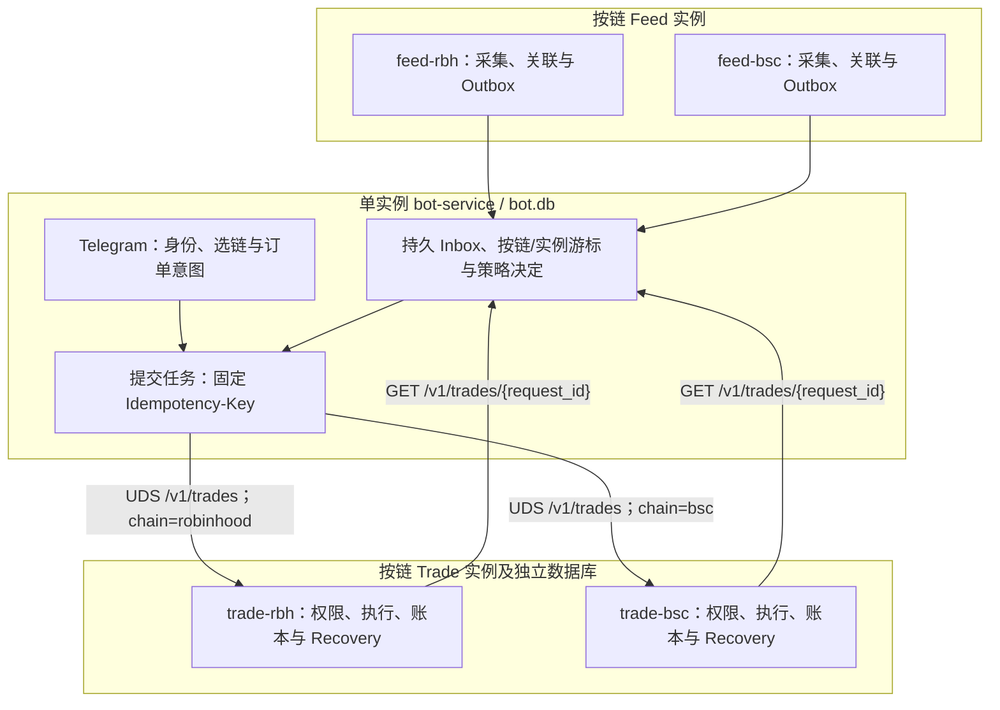

# EVM-Bot 多链交易与跟单系统落地规划文档（审查整合修订版）

> **状态**：`REVISED_PLAN_V2`（已合入 Codex 审查 `BLOCKED` 项修复与 `001..050` 真实 Schema 对齐补丁）；本轮为设计与实施计划修订，不表示代码已实现、测试已通过或已经获得实盘授权。  
> **修订日期**：2026-11-21。  
> **总目标**：将现有 `rbh-bot` 演进为对标 `sol-bot` 产品能力的多链 EVM 低延迟交易与跟单系统（`evm-bot`）。  
> **首期链与 SDK**：Robinhood 主网（V1 兼容键 `robinhood`，规范链键 `rbh`，ChainID `4663`）：`github.com/0xfnzero/rbh-trade-sdk`、`github.com/0xfnzero/rbh-parser-sdk`；BSC 主网（规范链键 `bsc`，ChainID `56`）：`github.com/0xfnzero/bsc-trade-sdk-golang`、`github.com/0xfnzero/bsc-parser-sdk-golang`。SDK、ABI、部署地址和解析器能力均按锁定版本验收。  
> **后续链**：Base、Arbitrum、Ethereum、Monad 等。在已支持的账户类型、交易格式和执行能力范围内通过适配器扩展；新增能力显式升级契约，不承诺任意 EVM 链都仅靠配置接入。

### 本轮修订与阅读说明（含 Codex 审查收敛补丁）

本文保留总体架构、目标目录和 `Step 0–5 / R0–R9` 引用；通过拆分 **`Step 1A`（RBH 首单正式闭环）**、**`Step 1B`（R6 同钱包连续交易）**、**`Step 1.5`（分项执行能力增强）** 与 **`Step 2A/2B`**，解除现有 `001..050` SQLite Schema 与实施步骤之间的硬冲突。

| 修订重点 | 正文位置 | 解决的冲突与 Codex 审查项 |
|---|---|---|
| **V1 单步单尝试 Schema (`1:1:1:1`) 与 V2 多步/多尝试迁移边界分离** | 5.1、6.3、6.4、7 | 解决现有 `015..045` 表以 `operation_id` 为唯一主键、触发器禁止同 Operation 多 Step / 多 Attempt / 多 Submission 的硬冲突 |
| **沿用 `manualAdmissionContinuation` 同栈一次性执行；`signing_intent` 保持失败关闭** | 5.1、6.7、7 (Step 1A)、9.2 | **Codex P1 #1 & #5**：重启不重跑未签名 `ADMITTED`、绝不从 `manual_signing_intents` 重调 signer；显式补齐 `foundation -> runtime capture -> first permit -> atomic consume` 连接点 |
| **拆分 Step 1A（首单）与 Step 1B（R6 钱包复用），解除 `007`/`045` 索引与触发器冲突** | 6.1、6.5、7 (Step 1A/1B) | **Codex P1 #2**：首单验收不被 R6 阻塞；Step 1B 显式改造 `one_active_canary_reservation_per_wallet` 与 `manual_recovery_no_wallet_reuse`，禁止消费未确认暂定买入产出 |
| **首版冻结 `broadcast_unknown`；SpeedUp/Cancel 与自动预授权后移至 Step 2B** | 6.3、6.4、7 (Step 2A/2B) | **Codex P1 #3 & #4**：`broadcast_unknown` 只查询对账；原字节重播须走 `query-first + UNKNOWN_REPLAY permit`；BSC 首切片先跑无需 Approve 或 allowance 已足的操作 |
| **Facts / AAD `v1` 与 `v2` 版本化隔离** | 5.6、6.2 | **Codex P2**：RBH 保留 `APPLICATION_TTL_ONLY` 与 `"rbh:4663:...:manual:v1:"` AAD 字节不变；新链与 `contract_deadline` 走 `v2`，保证旧库密文可恢复 |
| **OpenAPI `0.5.1` 兼容与 Bot 按 `(chain_id, feed_instance)` 独立消费游标** | 5.1、5.3、5.4 | **Codex P1 #6 & P2**：保留 `GET /v1/trades/{request_id}` 与字符串金额/滑点字段兼容；替换 `bot_progress WHERE id=1` 单游标，分离观察 ID 与跟单触发幂等键 |

---

## 1. 核心架构原则与演进策略

1. **先收拢唯一代码基线（R0），再打通闭环，按职责逐步演进**。保留有效迁移与历史执行事实，目录拆分随可验收切片推进；每个切片记录基线 SHA、迁移版本、能力开关和回退边界。
2. **单 Bot 聚合入口，Feed/Trade 按链独立部署与持有数据库**。
   - `bot-service` 独占 `bot.db`：Telegram、钱包公开视图、策略配置、按 `(chain_id, feed_instance_id)` 隔离的持久消费游标、持久 Inbox、提交任务、通知及后续限价单。
   - `feed-service` 每链独占 `feed-<chain>.db` 与 UDS：采集、解析、观察关联、Outbox、补历史与重组撤回。
   - `trade-service` 每链独占 `trade-<chain>.db` 与 UDS：Admission、钱包权限、执行、风险预占、签名制品、广播及 Recovery。链间不共享 Nonce 分配和写事务；同机部署仍需配置 CPU、磁盘、连接和队列上限，不能把进程拆分等同于全部资源隔离。
3. **首版范围明确**：
   - **V1 执行模型（Step 1A / 1B / 2A）**：遵循现有 `015..050` Schema 的 **`1 Operation = 1 ExecutionStep = 1 TransactionAttempt = 1 Primary Submission`** 约束（每笔 Operation 对应单笔链上交易：原生币买入、已具备足够 allowance 的卖出、或独立发起的单步显式 Approve Operation）。
   - **V2 扩展模型（Step 1.5 / 2B）**：通过以 `step_id / attempt_id / submission_id` 为主键的 additive schema 扩展，再开放单 Operation 内串联 `Approve -> Sell`、同 Step 下 `SpeedUp / Cancel` 替换 Attempt 及多 Relay 并发 Submission 记录。
4. **双层抽象**：链级连接、费用、广播、Nonce 观察和最终性由 `ChainProfile / EVMChainClient` 提供；协议路由、报价、无签名构建和效果解码由 `ProtocolAdapter` 提供。每个适配器声明能力，未知能力拒绝启用，不跨链或跨协议静默 fallback。
5. **一套权威交易状态机**：`Operation -> ExecutionStep -> TransactionAttempt -> Submission -> Receipt/Canonical/Reorg`。Bot 只持有投递与产品视图；权威执行结果、取消结果和资金账本以 Trade 为准。
6. **SDK 只承担受限能力**：禁止 SDK 隐含签名、发送、分配 Nonce、隐式 Approve 或自动创建替换交易。只读 RPC、纯构建端口与能力测试共同落实边界。
7. **先持久化再产生外部副作用，模糊边界失败关闭（Fail-Closed）**：受理、执行绑定、Nonce 认领、签名意图（`manual_signing_intents`）、签名制品（`manual_signed_artifact_commands`）、提交基座（`manual_submission_foundations`）、运行时门禁证据与首次广播许可（`FIRST_BROADCAST permit`）在各自事务边界提交后再推进。**`manual_signing_intents` 与 `send_intent` 均为不可逆的模糊边界（ambiguity boundary）**：一旦落盘后崩溃，未确认制品或回执前严禁自动重调 signer 或自动重发。
8. **实盘门禁逐链生效**：所有新实例默认 `live_enabled: false`。第 7 章 Step 5 是每条链首次 Live 前的横向门槛；修改本计划不构成执行真实交易或扩大权限的授权。

---

## 2. 总体系统拓扑



每个 Trade 实例内部依次装配 HTTP/IPC、Application、Execution/Risk、链能力与协议适配器、签名/广播边界和独立 Recovery worker。Recovery 可更新交易事实和账本，但不持有签名器、广播器或 Nonce 分配器。Feed Outbox 与 Bot Inbox 采用至少一次传递，业务决定和 Trade 受理由持久唯一约束实现幂等。

钱包明文导入通过独立受控入口直达 Trade/签名侧；Telegram 与 Bot 只持有钱包引用和公开地址。限价、止盈止损与 Alpha/Paper 后续接入同一提交任务入口，不绕过 Admission。

---

## 3. 代码现状与基线事实（Step 0 / R0 输入）

| 对象 | 已核对代码库事实 | 修订后的处理原则 |
|---|---|---|
| 当前分支与 `origin/main` | 当前 checkout `ab84f46`（migration 至 `043`）与本地 `origin/main@0f9caf5`（migration 至 `050`）各有 31 / 115 个独有提交；`http-abc-local-integration` 含未提交的 `HTTP_WALLET_REUSE_DESIGN.md` 修改与未跟踪的 `HTTP_WALLET_REUSE_MODEL_PROPOSAL.md` | R0 先固定唯一集成基线 SHA 并**保全所有工作树中的未提交/未跟踪修改**（不把“删除/清理 22 个 worktree”作为 R0 前置条件）；合入 `044–050` 及 A1–A4 有效成果 |
| 正式 HTTP 执行连接 | `worktrees/http-a3-trust-composition/internal/tradeapi/local_post_execution_harness_test.go` 已串起本地首单 harness，但正式 `app.Run` 尚未装配 foundation writer、runtime verifier、first permit issuer 与 submission executor | 在 Step 1A 中将 `binding -> nonce claim -> signing -> submission foundation -> runtime capture -> first permit issue -> atomic permit consume & send` 接入正式 `app` composition |
| 执行所有权与 continuation | `manual_admission_continuation.go` 是单调用栈一次性内存 token（`spent atomic.Bool` + `origin context.Context`），取消或崩溃即失效；`033_manual_signing_intent.sql` 禁止删改且不代表可重签许可 | Step 1A/1B/2A 严格沿用一次性 `manualAdmissionContinuation` 同栈推进；重启只查询原单并对账已落盘的 `submitted / broadcast_unknown`，绝不从 `ADMITTED` 或 `signing_intent` 自动恢复重签 |
| 同钱包连续交易硬锁 | `007` 建有 `one_active_canary_reservation_per_wallet`（`WHERE state IN ('reserved','frozen')`）；`045` 建有触发器 `manual_recovery_no_wallet_reuse` 直接 `RAISE(ABORT, 'MANUAL_WALLET_REUSE_UNSUPPORTED')` | 将 RBH 首单（Step 1A）与同钱包连续交易（Step 1B / R6）拆开；Step 1B 专门通过 additive migration 升级这两个约束并闭合“旧买单 canonical -> 新单在途 -> 旧买单 orphan”跨代风险 |
| 单 Operation 表结构约束 | `021..044` 的 `manual_execution_bindings`、`manual_nonce_claims`、`manual_signing_intents`、`manual_signed_artifact_commands`、`manual_submission_foundations`、`manual_first_submission_bindings` 均以 `operation_id` 为 PK/UNIQUE | 首版（Step 1A/1B/2A）保持 `1 Operation = 1 Step = 1 Attempt = 1 Submission`；多 Step 串联与同 Step 多 Attempt 替换放入 Step 2B 的 V2 表扩展切片 |
| Bot 单消费游标限制 | `internal/bot/store.go` 目前只查 `bot_progress WHERE id=1` 并按单个 `feed_offset` 在 `signal_inbox` 判重 | Step 3A 改为按 `(chain_id, feed_instance_id)` 维护独立游标，并分离观察去重键与跟单触发幂等键 |

### 3.1 R0 必须形成的证据

- 分支与 worktree 状态清单、未提交/未跟踪改动备份、选定的唯一基线 SHA。
- `043`、`050` 真实历史库的可重复升级样本与迁移校验和；新空库也可创建。同编号不同 SQL 必须解决，不改写已落地迁移字节。
- 带 `submitted / broadcast_unknown`、签名制品和 retained exposure 的历史数据在升级后仍可恢复。
- 错链数据库在任何写迁移前拒绝。旧库尚无 `chain_profile` 时，通过已知迁移谱系及历史签名交易/链记录识别，形成显式的一次性归属迁移；证据不足不自动认领。
- 四个 SDK 的准确 tag/commit、校验和、部署 ABI、可用方法及副作用缺口表；协议支持范围以此冻结。

---

## 4. 目标目录结构与依赖规则

### 4.1 演进目标目录结构

保留当前物理路径与 module path 直到基线收拢完成。下列是演进目标，未启用链/协议不提前创建空目录；目录中列出某协议不代表已支持。

```text
evm-bot/                         # 演进期间保留当前物理路径与 module path
├── cmd/
│   ├── trade-service/           # 同一程序，按链/环境分别部署实例 (trade-rbh, trade-bsc...)
│   ├── feed-service/            # 按链/环境分别部署实例 (feed-rbh, feed-bsc...)
│   ├── bot-service/             # Telegram + 跟单 + 限价单（零私钥/零签名依赖）
│   └── operator/                # 运维 CLI：备份恢复校验、离线回放、只读诊断、授权管理
├── api/
│   └── openapi/                 # user-trade-api.openapi.yaml
├── internal/
│   ├── app/                     # composition root、启动、drain；按服务拆分装配函数
│   ├── tradeapi/                # 保留现有 HTTP package 与 manual_* 组件，逐步抽薄
│   ├── application/             # 用例编排和私有 typed handoff
│   ├── trade/                   # 现有核心状态机、execution、recovery、risk store
│   ├── manualartifact/          # 版本化 Facts / AAD (v1 & v2) 与加密验签
│   ├── manualnonce/             # Nonce 观察与校验
│   ├── manualrisk/              # 精确单位风险策略与保留敞口计算
│   ├── manualsign/              # 本地无副作用签名器封装
│   ├── chains/
│   │   ├── evm/                 # 可复用只读 RPC（Keep-Alive）、交易格式与链验证基础设施
│   │   ├── robinhood/           # ChainProfile (4663, Sequencer/总费用/最终性策略)
│   │   ├── bsc/                 # ChainProfile (56, 零 baseFee 计价/最终性/广播策略)
│   │   └── base/                # Base 实施阶段创建 (8453, L2+L1 data fee)
│   ├── protocols/
│   │   ├── ports/               # ProtocolAdapter 窄接口与纯值类型（不依赖具体 SDK）
│   │   ├── pons/v2curve/        # Robinhood Pons v2 Curve 适配器
│   │   ├── flap/                # Flap 候选适配器（按链与 deployment revision 隔离）
│   │   ├── fourmeme/            # BSC Four.meme 候选适配器
│   │   └── pancakeswap/{v2,v3}/ # BSC PancakeSwap v2 / v3 候选适配器
│   ├── integrations/
│   │   ├── rbhtrade/            # 锁定版本的 rbh-trade-sdk 纯构建/报价封装
│   │   ├── rbhparser/           # 锁定版本的 rbh-parser-sdk 封装
│   │   ├── bsctrade/            # 锁定版本的 bsc-trade-sdk-golang 纯构建/报价封装
│   │   └── bscparser/           # 锁定版本的 bsc-parser-sdk-golang 封装
│   ├── registry/                # chain + protocol + deployment 不可变注册表
│   ├── feed/                    # 观察/动作关联、Outbox、补历史与 Reorg 撤回
│   ├── bot/                     # Telegram、多源持久 Inbox/游标、策略与路由缓存
│   ├── storage/                 # SQLite WAL（DSN PRAGMA、写单连接+读连接池、迁移、Retention）
│   ├── ipc/                     # UDS HTTP、HMAC 鉴权（有界防重放）、RequestID
│   ├── health/                  # 活性探测防覆盖 Socket、Readiness 门禁、Buffered Metrics
│   └── observability/           # 结构化日志、分阶段延迟/队列/恢复指标
├── configs/
│   ├── chains/                  # rbh.yaml, bsc.yaml
│   └── policies/
└── tests/
    ├── fixtures/                # 各链真实脱敏 RPC / ABI / Receipt 样本
    ├── contract/                # ProtocolAdapter 统一契约测试套件
    └── integration/             # 正式 HTTP 入口 + 本地受控 RPC 端到端验收
```

### 4.2 严格依赖方向与能力边界

| 调用方 | 允许依赖 | 不允许持有或调用 |
|---|---|---|
| `cmd/trade-service -> internal/app` | HTTP、Application、Registry、Trade/Execution、Risk、Recovery、Storage 的装配 | 在 HTTP handler 内另写第二套独立账本状态机 |
| `application / tradeapi` | 用例编排、权限、预算、同栈 `manualAdmissionContinuation` 推进 | 绕过执行记录直接调用 SDK 高层交易方法，或凭公开 `request_id` 重建已销毁的 continuation |
| `protocols/<proto>`、`integrations/<sdk>` | `protocols/ports` 纯值类型、受限只读 RPC、ABI 与构建器 | 私钥、signer、broadcaster、Nonce allocator、DB 写句柄、隐藏网络写入 |
| `recovery` | 历史绑定、只读链查询、`DecodeEffects`、受 fence 保护的状态和账本写入 | signer、broadcaster、发送 permits、Nonce allocator |
| `bot-service` | 自有数据库、Feed 消费接口、Trade 用户 API（`/v1/trades`）、公开钱包信息 | Trade 数据库直读直写、钱包明文私钥、链签名、内部 prepare/send 路由 |
| `feed-service` | 自有数据库、数据源、解析器和观察状态 | 创建交易、使用交易钱包私钥或修改 Trade 风险记录 |

---

## 5. 核心接口与多链数据契约

### 5.1 用户与内部下单 HTTP 契约（`POST /v1/trades`）与 OpenAPI `0.5.1` 兼容规则

#### 5.1.1 请求/响应格式与版本兼容（解决 Codex P2 接口冲突）
为保证现有 `internal/tradeapi/http.go` 的 `strictObject` 解析器、`docs/user-trade-api.openapi.yaml`（`0.5.1`）及 C 线契约测试 100% 兼容，**Step 1 严格保留现有 V1 请求/响应契约与路由路径**：
- 下单：`POST /v1/trades`（必填 Header：`Authorization: Bearer <token>`、`Idempotency-Key: <id>`）
- 按请求 ID 查询：`GET /v1/trades/{request_id}`（返回 `Location: /v1/trades/{request_id}` 指向的 `TradeRecord`，内含关联的 `operation_id`）
- 按幂等键找回：`GET /v1/trades/by-idempotency-key?idempotency_key=...`
- 审计事件流：`GET /v1/trades/{request_id}/events?after=...`

**V1 现行请求结构（Step 1A / 1B 直接使用，所有金额与比例均为十进制字符串，`ttl_seconds` 为正整数）**：
```json
{
  "chain": "robinhood",
  "wallet_id": "wallet-01",
  "token": "0x2000000000000000000000000000000000000002",
  "side": "buy",
  "amount": "0.01",
  "slippage_percent": "3",
  "ttl_seconds": 60,
  "fee": { "max_gwei": "3", "tip_gwei": "0.2", "max_total_native": "0.001" }
}
```
> **V2 协议扩展规则（Step 2A 启用，记录独立的 `request_schema_version = 2`）**：
> - 在 `strictObject` 中以向后兼容方式新增可选字符串字段 `"protocol"`（如 `"auto"`、`"pons-v2-curve"`、`"four-meme"`、`"pancake-v2"`）；
> - `chain` 字段按实例注册表精确匹配（RBH 实例接受 `"robinhood"`；BSC 实例接受 `"bsc"`；严禁跨链 fallback）；
> - 旧请求升级后仍按其落盘时的 `request_schema_version = 1` 计算规范化哈希，绝不给历史请求补默认字段而改变 `request_fingerprint`。

#### 5.1.2 首次 Admission 同栈一次性 Handoff（解决 Codex P1 #1 & P1 #5）
- **首期执行所有权模型（Step 1A / 1B / 2A）**：
  - `POST /v1/trades` 完成身份鉴权、严格 JSON 校验、幂等查重、只读链上验证（C2）和原子准入（C3-C）后，**仅首次 durable admission 胜出的那一个未中断 HTTP 调用栈**获得私有的、不可序列化的 `manualAdmissionContinuation`（`spent atomic.Bool` + `origin context.Context`）。
  - 在该胜出调用栈内，按固定顺序同步推进以下持久阶段：
    1. `manualExecutionBindingWriter.bind`（写入 `manual_execution_bindings`）
    2. `manualNonceClaimWriter.claim`（写入 `manual_nonce_claims` 与 `transaction_attempts`）
    3. `manualLocalSigningWriter.sign`（先写入 `manual_signing_intents` 模糊边界，立即复核 writer fence，调用本地无副作用 signer，校验后写入 `manual_signed_artifact_commands`）
    4. `manualSubmissionFoundationWriter.write`（从 `manual_submission_foundation_expected` 视图派生并写入 `manual_submission_foundations`）
    5. `manualRuntimeVerifier.capture`（采集当前 runtime clock/control/auth/lease/gate 证据写入 `manual_runtime_gate_snapshots`）
    6. `manualFirstBroadcastIssuer.issue`（签发 `FIRST_BROADCAST` one-shot `canary_send_permits`）
    7. `manualSubmissionExecutor.execute`（在同一 SQLite 事务中原子写入 `manual_first_submission_bindings`、消费 permit、创建 `transaction_submissions(state='submitting')`，随后落盘 `send_intent_at`，调用 exact-byte transport 广播并记录 `submitted / broadcast_unknown / known_unsent`）
  - **重启与断连边界**：
    - 如果进程在 `ADMITTED` 后、进入 `manual_first_submission_bindings` 前崩溃或请求取消，一次性 `manualAdmissionContinuation` 立即销毁；
    - **重启或重复 POST 绝不凭历史 `ADMITTED` 或 `manual_signing_intents` 自动重跑未完成步骤或重调 signer**；重复 POST 仅按幂等键返回当前已持久化的真实记录状态；
    - 已经到达 `submitting / submitted / broadcast_unknown` 的交易由后台唯一 Recovery worker 在重启后自动发现并持续对账。
  - **后续可选异步持久调度器**：若未来产品要求“返回 202 后异步排队执行”，必须作为独立设计切片引入带 lease epoch fence 的持久调度器，并先证明签名前后崩溃与双 worker 接管下绝不重复调用 signer；不在 Step 1/2A 混入。

### 5.2 `ChainProfile` 与 `ProtocolAdapter` 双层契约

#### 5.2.1 链身份、交易格式与策略能力
`ChainProfile` 定义规范链键、ChainID、主网/测试网环境、genesis/checkpoint、原生币与 Wrapped 地址、RPC 身份验证和各项能力。`profile_revision`、部署版本与历史绑定一同持久化；升级策略不能改写历史交易的解释方式。

| 能力 | 必须描述的内容 |
|---|---|
| `AccountCapabilities` | 首版仅支持常规 EOA（`code == empty`）；签名前检查实际账户代码，拒绝带代码的委托/智能合约账户 |
| `TxEnvelopeCapabilities` | Legacy、Type-2 (EIP-1559) 等格式及支持约束，独立于实际费用算法 |
| `FeePolicy` | 有效 Gas 计价、估算方法、L1/其他费用组成、估算是否已包含这些组成、预算上界及结算来源 |
| `OrderingPolicy` | 公共交易池、Sequencer 等排序模型；费用变化是否影响排序 |
| `ReplacementPolicy` | 首版（Step 1A/1B/2A）固定为 `DISABLED`；Step 2B 按链与 Relay 能力显式配置允许的替换场景、增幅、预算与次数 |
| `FinalityPolicy` | 允许推进下一 Nonce 的 canonical 纳入条件、释放 retained exposure 的最终性证据、节点落后/冲突的降级规则 |
| `RPCReadCapabilities` | `safe/finalized`、按 block hash 查询（EIP-1898）、顺序模拟、历史数据可用性；启动时验证所需能力 |
| `SubmissionPolicy` | `public` / `private_only` / `private_then_public` 传输范围、超时后的 `broadcast_unknown` 冻结语义 |

#### 5.2.2 首期链差异与费用预算
- **RBH（ChainID `4663`）**：Arbitrum Orbit L2，ETH 为 Gas 资产，Sequencer 先到先排序。`eth_estimateGas` 已折算 L1 数据成本，Profile 明确标记 `EstimateIncludesL1DataFee: true`，防止重复叠加 L1 Fee。[网络配置](https://docs.robinhood.com/chain/connecting/) · [费用说明](https://docs.robinhood.com/chain/gas-and-fees/)
- **BSC（ChainID `56`）**：官方客户端 `EffectiveGasPriceForBSC` 使用零 base fee 计算有效价格，不能照搬以太坊动态 base fee 公式。最终性优先使用已验证的 `safe/finalized` 或 `eth_getFinalizedHeader`；节点不支持时按保守确认深度策略处理。[客户端](https://github.com/bnb-chain/bsc/blob/master/core/types/transaction.go) · [最终性 API](https://docs.bnbchain.org/bnb-smart-chain/developers/json_rpc/bsc-api-list/)
- **Base（ChainID `8453`，后续扩展）**：OP Stack L2，必须单独计算并预占 L2 execution fee + L1 data fee 上界，不能仅用 `gas_limit * max_fee_per_gas`。

#### 5.2.3 广播隐私与多 Relay 混合结果语义（含 Codex P1 #3 修正）
- **首版单主通道 exact-byte 传输（Step 1A / 1B / 2A）**：每次 `FIRST_BROADCAST` permit 消费对应单次确定性 exact-byte 传输调用；`private_only` 模式下严禁在超时或失败时静默回退到公共 RPC。
- **多 Relay 并发广播（Step 2B 扩展）**：
  - 当配置向多个私有/公共 Relay 并发推送同一已签名原字节（同一 `tx_hash`）时，每个 Relay 的调用结果独立记录，但**整体 Attempt 的广播状态采取最保守的“可能已传播”优先合并规则**：
    - 只要任一 Relay 返回成功/`already known`，整体为 `submitted`；
    - 若 Relay A 超时/连接断开、Relay B 明确拒绝（如格式/费率拒绝），整体**仍必须标记为 `broadcast_unknown`**（绝不能因为 B 拒绝就判为 `known_unsent`），保留 Nonce Lane 与风险预占冻结直至链上对账明确。

#### 5.2.4 `ProtocolAdapter` 窄接口

| 方法 | 输入 | 输出 | 约束 |
|---|---|---|---|
| `Describe` | 锁定的 adapter revision | chain/side/pool phase/quote asset/账户类型、是否要求 allowance、deadline 能力（`APPLICATION_TTL_ONLY` vs `CONTRACT_DEADLINE_UNIX`） | 纯元数据，不改变权限；能力描述随版本冻结 |
| `Resolve` | 链配置、Token、受限只读 RPC、区块锚点、可选缓存 hint | 验证过的 factory/pool/router/curve/Token 身份、runtime codeHash、代理实现（适用时）、部署版本与池阶段 | 不信任调用方传入的 codeHash，不发送交易 |
| `Quote` | 已解析路由、原子整数输入、只读快照 | expected output、费用/税费组成、最低输出 `minOut`、报价区块哈希 | 不预占风险、不分配 Nonce、不发 Approve |
| `BuildUnsigned` | 已验证冻结参数（金额、recipient、`minOut`、route revision、可选派生 `contract_deadline`） | 无签名 `to/value/calldata`、实际 spender、语义摘要 | **不签名、不发送、不暗中发 Approve、不写 DB** |
| `DecodeEffects` | 原绑定身份、已验证 Receipt/Logs | 标准化成交、资产效果及证据完整性标记 | 纯只读解码；Recovery 仅注入此窄接口，不可接触 builder 或 SDK 发送客户端 |

#### 5.2.5 SDK 能力矩阵与适配器准入
在 R0 / Step 2A 锁定 commit 后核验下表。未经源码与固定样本核验的能力一律标为 `UNVERIFIED` 并默认关闭：

| SDK / 协议范围 | 锁定版本 | Resolve | Quote | 纯 BuildUnsigned | Receipt Decode | 必须隔离的 SDK 副作用入口 | 准入计划 |
|---|---|---|---|---|---|---|---|
| `rbh-trade-sdk` / Pons v2 Curve | `v0.4.0` (已锁定) | 已实现 | 已实现 | 已实现 (`pons` adapter) | 已实现 | 不使用任何带 signer/send 的高层封装 | **Step 1A 首发闭环** |
| `rbh-parser-sdk` / Pons v2 Curve | `v0.4.0` (已锁定) | Registry 快照恢复 | 不适用 | 不适用 | Receipt & Sequencer 解析 | Sequencer `OnSequence` 不作持久位点 | **已接入 `feed-service`** |
| `bsc-trade-sdk-golang` / Four.meme 或 Flap 曲线 | Step 2A 锁定 commit | 待核验 | 待核验 | 核验 `FourBuilder` 等纯构建方法 | 待核验 | 严禁注入 SDK `Signer` / `NonceManager` / `Submitter` | **Step 2A 选定单一已核验协议/阶段** |
| `bsc-trade-sdk-golang` / PancakeSwap V2/V3 | Step 2A 锁定 commit | 待核验 | 待核验 | 核验 `PancakeBuilder` 与 `deadline` 参数 | 待核验 | 严禁调用隐式 `Approve` 或自动发送 | 视 `deadline` (Step 1.5) 验收后在 Step 2A/2B 启用 |
| `bsc-parser-sdk-golang` | Step 3A 锁定 commit | 待核验 | 不适用 | 不适用 | 待核验 | 网络 WS/RPC 采集与游标由 `feed-bsc` 负责 | **Step 3A 接入** |

### 5.3 标准化观察与成交事件契约（`NormalizedSwapEvent` v2）

为解决“同一笔 Swap 经 mempool/sequencer 与 receipt 两路到达导致重复跟单”（**Codex P1 #6**），Feed 事件严格分离三层身份：

| 身份字段 | 生成规则 | 用途与去重边界 |
|---|---|---|
| `observation_id` | `chain_id : feed_instance_id : source : tx_hash : source_seq_or_log_index : stage` | 单次观察记录/生命周期更新的唯一 ID；用于 `feed_events` 与 Bot `signal_inbox` 的**消息级投递幂等** |
| `trigger_id` | `chain_id : tx_hash : protocol : canonical_action_key`（**不含 `source`、不含 `block_hash`**） | 同一笔链上交易内同一个经济动作的**跨来源统一触发 ID**；同一笔 Swap 无论先从 sequencer/mempool 还是后从 receipt 到达，抑或 Reorg 后重新入块，都映射到同一个 `trigger_id`，最多只生成一个跟单意图 |
| `inclusion_id` | `chain_id : block_hash : tx_hash : canonical_action_key` | 具体某个区块中的成交事实；用于账本/观察统计在 Reorg 时的撤回与重算 |

- **默认触发阶段**：首版（Step 3A）每条跟单策略绑定单一触发阶段，默认采用经确认的 `included`（Receipt/已验证区块事件）生成跟单意图；sequencer/mempool `intent` 阶段仅预热路由缓存或更新观察视图，彻底避免“未上链失败交易骗触发”以及“intent 与 receipt 双重触发”。

### 5.4 Feed → Bot → Trade 的按链独立游标、持久投递与新鲜度（解决 Codex P1 #6）

1. **Bot 按 `(chain_id, feed_instance_id)` 维护独立消费游标**：
   - 废弃单行 `bot_progress WHERE id=1` 与 `signal_inbox(feed_offset)` 全局无链区分的查重方式。
   - 新增/升级为 `bot_feed_cursors(chain_id, feed_instance_id, durable_event_offset, updated_at, PRIMARY KEY(chain_id, feed_instance_id))`，`signal_inbox` 唯一键升级为 `(chain_id, feed_instance_id, feed_offset)` 与 `(chain_id, observation_id)`。
   - **验收要求**：`feed-rbh` 与 `feed-bsc` 同时发送 `offset = 1` 时，Bot 各自独立消费推进，互不冲突。
2. **经济动作去重与固定 `Idempotency-Key`**：
   - 跟单根决定表 `copy_signal_decisions` 以 `(principal_id, strategy_id, chain_id, trigger_id, action_kind)` 为 `UNIQUE` 约束。
   - 当同一笔 Swap 先后从两个 `source` 到达时，第二次到达因 `trigger_id` 已存在，仅更新观察阶段元数据，**绝不创建第二条跟单下单任务**。
   - 每个获准的跟单决定在落盘事务中确定唯一且不可变的 `trade_idempotency_key = sha256(decision_id + wallet_id)`；调用 `POST /v1/trades` 超时、断连或 Bot 重启后重试，始终携带同一 `Idempotency-Key`。
3. **瞬态容错与信号新鲜度（`max_signal_age_ms`）**：
   - `bot-service` 拉取 Feed Outbox 遇到 UDS/网络瞬态错误时采用带抖动的指数退避（不直接退出进程）；拉满 batch（如 100 条）时立即继续排空下一批。
   - 恢复连接后，若事件 `now - first_observed_at > max_signal_age_ms`，仅推进消费水位并记录 `EXPIRED_SKIPPED`，**严禁在断流恢复后集中补买过期历史信号**。

### 5.5 路由缓存、报价快照和失效

- `bot-service` 与 `trade-service` 可维护 `(chain_id, protocol, deployment_revision, token, pool_phase)` 路由缓存以加速发现，但缓存仅作为 `Resolve` 的候选 hint；`trade-service` 在准入与签名前必须通过只读 RPC 与一致区块锚点（EIP-1898 `blockHash + requireCanonical`）核对 `runtime_code_hash`、池阶段（未毕业 vs 已毕业）与报价。
- 曲线毕业迁移、区块重组、合约 codeHash 变化或报价失败立即使缓存失效，失败关闭，不静默切换到用户未授权的协议。

### 5.6 钱包安全、多版本密钥环与 Facts/AAD 版本隔离（解决 Codex P2）

- **多版本密钥环（Keyring）**：
  - `AESGCMCipher` 升级为支持 `active_key_version`（用于新制品加密）与 `historical_keys map[string]cipher.AEAD`（用于按制品记录的 `key_version` 解密历史制品），解决单密钥版本无法轮换的问题。
- **Facts 与 AAD 版本隔离（`v1` vs `v2`）**：
  - **`v1`（现有 RBH / Pons v2 Curve 冻结格式）**：完全保留 [internal/manualartifact/identity.go](file:///root/http/rbh-bot/internal/manualartifact/identity.go#L190-L197) 与 [033_manual_signing_intent.sql](file:///root/http/worktrees/http-a3-trust-composition/internal/storage/migrations/trade/033_manual_signing_intent.sql#L5-L25) 的 JSON 字段顺序、`deadline_capability="APPLICATION_TTL_ONLY"`、`contract_deadline=false` 以及 AAD 字节 `"rbh:4663:" + f.OperationID + ":" + f.ExecutionStepID + ":" + f.AttemptID + ":manual:v1:" + digest`。任何升级不得改动 `v1` 的一字节，确保旧库与旧制品 100% 可由 Recovery 解密验证。
  - **`v2`（Step 1.5 / Step 2A 引入的多链与受控 Deadline 格式）**：仅当 `chain_id != 4663` 或协议启用 `CONTRACT_DEADLINE_UNIX` 时，使用 `Facts.Version = 2` 及显式包含 `chain_id`、`protocol_id`、`adapter_revision`、`deadline_capability`、`contract_deadline` 的 `AAD v2`（`"evm:" + chainID + ":" + f.OperationID + ":" + f.ExecutionStepID + ":" + f.AttemptID + ":manual:v2:" + digest`）。Recovery 根据落盘的 `artifact_version` 分派 `v1` 或 `v2` 验证器。

---

## 6. 交易执行、风险守恒与恢复机制

### 6.1 同钱包连续交易（Step 1A 单单隔离 vs Step 1B / R6 跨代保留敞口）

为回应 **Codex P1 #2**，将“RBH 首单正式闭环”与“同钱包连续交易（R6）”明确解耦为两个阶段：

#### 6.1.1 Step 1A：保持单钱包单单硬约束，最快交付 RBH 正式首单闭环
- 在 Step 1A 中，**不修改** `007_controlled_canary_hardening.sql` 的 `one_active_canary_reservation_per_wallet` 唯一索引，也**不删除** `045_manual_recovery.sql` 的 `manual_recovery_no_wallet_reuse` 触发器。
- 每个钱包在 Step 1A 仅允许完成首单并经历完整的提交、回执确认、Reorg 回滚与重启恢复验收；同钱包第二单继续按 `MANUAL_WALLET_REUSE_UNSUPPORTED` 明确拒绝。

#### 6.1.2 Step 1B（R6）：同钱包串行连续交易与跨代 Reorg 守恒模型
在 Step 1A 验收通过后，Step 1B 采纳并落地 `worktrees/http-abc-local-integration/docs/HTTP_WALLET_REUSE_MODEL_PROPOSAL.md` 的**串行执行 + 累计保留总敞口（Serial Execution with Retained Gross Exposure）**模型：

1. **三项职责分离（不建第二套账本）**：
   - **执行所有权（Execution Ownership）**：同一 `(chain_id, normalized_wallet_address)` 同一时刻最多只有 **1 个未决代数（unresolved generation）** 可以发起新动作。前序所有世代必须全部处于 `canonical_success` 或 `canonical_revert`，且当前链上只读观察确认前序 Receipt 仍在 canonical 链上、`confirmed_nonce == pending_nonce == expected_next_nonce`，才允许准入下一代新订单。
   - **保留总敞口（Retained Gross Exposure）**：不回收历史世代已占用的 gross input / native gas outlay（成功、Revert、超时均不退回该保守累计值），直至达到显式配置的 operator 策略上限（`max_wallet_retained_input` / `max_wallet_retained_native_outlay`）。
   - **禁止未决/暂定产出依赖（Collateral Solvency Rule）**：针对“前序 BUY 产出 Token 随后被 SELL 卖出，而前序 BUY 之后发生 Reorg Orphan”的偿付冲突，Step 1B 明确规定：**当钱包存在尚未达到 `FinalityPolicy` 终局确认的前序 BUY 世代时，禁止准入针对同一 Token 的 SELL 订单（或要求前序 BUY 达到配置的终局确认深度后才可卖出该资产）**。
2. **解除 `007` 唯一索引与 `045` 触发器冲突的具体 Schema 迁移（Step 1B Additive Migration）**：
   - **问题根源**：`007` 的 `CREATE UNIQUE INDEX one_active_canary_reservation_per_wallet ON canary_risk_reservations(wallet_id) WHERE state IN ('reserved','frozen')` 在“第 1 代已 `settled` -> 第 2 代刚准入处于 `reserved` 或 `frozen` -> 第 1 代突然发生 Reorg 需要从 `settled` 回退为 `frozen`”时，会因为同一个 `wallet_id` 出现两条 `reserved/frozen` 记录而触发 `UNIQUE constraint failed`，导致第 1 代的 Reorg 回滚事务崩溃！
   - **迁移方案**：
     - 在 Step 1B 新增迁移（如 `051_manual_wallet_reuse_retained_exposure.sql`）中，将 `one_active_canary_reservation_per_wallet` 替换为**区分“当前活跃未决准入（`reserved`）”与“历史世代 Reorg 冻结（`frozen`）”**的约束：同一钱包最多只能有 **1 条 `state = 'reserved'`** 的新准入预占，而允许历史已提交世代在发生 Reorg 时原子回退为 `state = 'frozen'`；
     - 同时更新 `manual_recovery_no_wallet_reuse` 触发器：仅当该钱包（按 `wallet_id` 或 `lower(wallet_address)`）存在**未达 canonical 结论的世代（`reserved / signing / signed / submitting / submitted / broadcast_unknown / orphaned / reconciling`）**、或存在任何 `state IN ('reserved', 'frozen')` 的风险预占、或累计 Retained Gross Exposure 超出策略上限时，才拒绝新准入；
     - 一旦旧世代发生 Reorg 回退为 `orphaned / frozen`，钱包立即对**新动作**冻结（拒绝第 3 代准入，且若第 2 代尚未消耗 `FIRST_BROADCAST` permit 则在最终发送门禁拦截），同时保留第 2 代已签名/已广播制品的正常查询与对账，绝不篡改或删除第 2 代记录。

### 6.2 受控 Contract Deadline 与订单过期（含 Codex P2 修正）

1. **RBH / Pons v2 Curve 保持 `APPLICATION_TTL_ONLY`**：
   - 在 Step 1A / 1B 中，完全保持现有 `APPLICATION_TTL_ONLY` 语义（`contract_deadline = false`，`Facts v1 / AAD v1`），不添加合约层 deadline。
2. **新协议受控 `CONTRACT_DEADLINE_UNIX`（Step 1.5 / Step 2A）**：
   - 仅当新协议 ABI（如 PancakeSwap V2 Router）强制要求 `deadline` 参数时，该 `ProtocolAdapter.Describe()` 显式声明 `DeadlineCapability: CONTRACT_DEADLINE_UNIX`。
   - 准入时由不可变 `expires_at` 确定性派生 `contract_deadline = expires_at.Unix()`，使用 **`Facts v2 / AAD v2`** 编码并落盘；严禁修改 `v1` 视图与 `v1` 解密器。
3. **过期不释放已签名/已广播责任**：
   - `now >= expires_at` 仅阻止尚未签名的订单进入 signer、或阻止尚未消费 `FIRST_BROADCAST` permit 的订单发起首次广播；
   - 一旦进入 `send_intent / submitted / broadcast_unknown`，即使已过 `expires_at`，Nonce Lane 与风险预占依然保持保留，Recovery 持续追踪直至链上结局确定。

### 6.3 ERC-20 Approve 显式生命周期（含 Codex P1 #4 修正）

为避免在首个 BSC 切片中引入未经授权的隐式花销或跨 Step 状态机冲突，Approve 按以下两阶段递进实施：

1. **阶段 A（Step 2A 首版 BSC 切片）：只读 Allowance 门禁 + 独立显式 Approve Operation**
   - **买单（Native -> Token）**：无需 Approve，直接走 `1 Operation = 1 Swap Step`。
   - **卖单（Token -> Native）**：在 C2 验证与准入阶段通过只读 RPC 检查 `allowance(owner, spender) >= required_amount`（spender 必须来自 `ProtocolAdapter.Resolve` 锁定的受信合约，且检查 `>= required_amount` 而非 `== 0`）。
     - 若 `allowance >= required_amount`：直接准入执行 Sell Operation；
     - 若 `allowance < required_amount`：直接返回明确的 `ALLOWANCE_INSUFFICIENT`（附带所需 `token`、`spender`、`required_amount`），**绝不在买单后自动发 Approve，也不在 Sell Operation 内隐式插入 Approve**。
   - **独立显式 Approve Operation（可选或 Step 1.5 子项）**：用户/调用方可显式提交一笔独立的 `approve` 请求（绑定明确的 `token`、`spender`、精确授权额度 `amount`、独立 `gas_budget`、独立 `Idempotency-Key`、独立 `Nonce` 与 `FIRST_BROADCAST` permit）。即便后续 Sell 未发起或失败，该笔独立 Approve Operation 的账本、费用与恢复状态也完全自洽。
2. **阶段 B（Step 2B 进阶切片）：单 Operation 多 Step 串联与策略级买后预授权**
   - 仅在完成 V2 多 Step 表结构扩展（将 binding/nonce/signing/submission 主键从 `operation_id` 解耦到 `execution_step_id`）后，才开放单次请求内自动串联 `Approve Step -> Sell Step` 以及策略显式开启的买后预授权。

### 6.4 `broadcast_unknown` 冻结、原字节重播与后续 SpeedUp/Cancel（解决 Codex P1 #3）

1. **首版（Step 1A / 1B / 2A）：`broadcast_unknown` 严格保持冻结，只做查询对账，移出 SpeedUp / Cancel**
   - 当广播超时、连接中断或多 Relay 返回混合非确定性结果时，Submission 状态记为 `broadcast_unknown`。
   - **`broadcast_unknown` 下严禁生成新签名制品、严禁提价重签（SpeedUp）、严禁发 0 值自转（Cancel）、严禁因超时或重启释放 Nonce Lane 与风险预占**。
   - 即使链上 `eth_getTransactionCount(latest)` 尚未推进，原签名交易仍可能保存在某节点或私有 Relay 内存池中；此时唯一合法的自动后台动作是 **Recovery 的只读 Receipt / Tx / Nonce 查询对账**。
2. **受控原字节重播（Raw Replay，需独立 `UNKNOWN_REPLAY` Permit）**：
   - 如需支持对 `broadcast_unknown` 重推**完全相同的已落盘 `SignedArtifact` 原字节（同一 `tx_hash`、同一 `raw_sha256`）**，必须严格遵守已冻结的广播语义（[CONTROLLED_CANARY_WIRING.md](file:///root/http/rbh-bot/docs/CONTROLLED_CANARY_WIRING.md#L235)）：
     1. 先执行只读 **`tx / receipt / nonce query-first`**（若链上已存在 receipt 或 `confirmed_nonce > claim.nonce`，转入对账，禁止重发）；
     2. 重新通过 runtime verifier 检查当前 control / emergency stop / authorization / lease 门禁；
     3. 签发并原子消费独立的 one-shot **`UNKNOWN_REPLAY` permit**（严禁复用已消费的 `FIRST_BROADCAST` permit）；
     4. 仅发送原加密制品解密校验后的 exact raw bytes。
3. **同 Nonce 提价替换（SpeedUp / Cancel）后移至 Step 2B**：
   - 只有在 Step 2B 完成 V2 多 Attempt 表结构（允许同一 `execution_step_id` 关联多个竞争 `attempt_id` 并追踪所有历史 `tx_hash` 直至 Finality）后，才按链策略设计受控 Replacement。

### 6.5 原子风险预算与资产账本

- 所有金额与 Gas 运算使用精确 uint256 / 十进制整数（复用 `internal/manualrisk/units.go` 与 SQLite `manual_u256_*` 函数），严禁使用浮点数。
- 原生币支出上界覆盖 `tx.value + gas_limit * gas_fee_cap + UnbundledL1DataFeeBound`（按 `ChainProfile` 标注是否已含在 `gas_limit` 中，防漏计与防双计）。
- 每次准入原子扣减 `canary_authorization_usage`（`operation_count` 与 `total_input`）；幂等重复请求不重复扣减，Reorg 或 Revert 不退回已消耗的 lifetime authorization usage。

### 6.6 报价冻结、模拟与签名前验证

- `Resolve` 与 `Quote` 在同一区块锚点（`quote_block_number`、`quote_block_hash`）下执行：先读取区块头，再按该区块锚点读取合约 `eth_getCode`（校验 `runtime_code_hash`）、余额、报价与 `eth_call` / `eth_estimateGas` 模拟，最后复核区块锚点未发生分叉漂移（复用 [internal/chainquery/client.go](file:///root/http/rbh-bot/internal/chainquery/client.go#L215-L234) 的 `begin / finish` 快照锚定模式）。
- 签名前与首次广播前，由 `manualRuntimeVerifier` 重新核对当前链上观察（`observed_at` 单调递增、nonce 一致、合约 codeHash 未变、订单与授权未过期、未触发 Emergency Stop）。

### 6.7 单 Owner、Fence、暂停与恢复职责

- `SUBMISSION` 与 `RECOVERY` 使用独立的 `canary_worker_leases(role, environment, holder_id, lease_epoch, expires_at)`。
- 任何状态迁移在 SQLite 写事务内校验 `holder_id` 与 `lease_epoch` fence；租约过期后新实例通过递增 `lease_epoch` 接管，旧实例残留 goroutine 的延迟写入被触发器/WHERE 条件直接拒绝。
- **无 Signer 的查询 + Recovery 启动模式**：支持在不注入 `RBH_EXECUTION_PRIVATE_KEY` 的情况下启动 `trade-service`，此时对外提供 `/v1/` 只读查询，同时在内部启动持有 `RECOVERY` lease 的唯一 Recovery worker 继续对账历史 `submitted / broadcast_unknown` 订单，依赖图中完全不存在 signer 或 broadcaster。

---

## 7. 分阶段实施路线图（Step 0 ~ Step 5）

本路线图已根据 Codex 审查结论完成解耦：**先交付 RBH 正式首单闭环（Step 1A），再并行推进同钱包连续交易（Step 1B）与通用协议扩展（Step 1.5 / Step 2A）**。

```text
Step 0A/0B (R0 基线固定 + 保全 worktree + P0 底座加固)
  ├──> Step 1A (R1-R5: RBH 正式 HTTP 首单闭环 + Recovery 重启验收，保留单钱包单单约束)
  │      ├──> Step 1B (R6: 同钱包连续交易迁移，解除 007/045 冲突 + 保留总敞口模型)
  │      └──> Step 1.5 (Facts/AAD v2 + 受控 Deadline + 独立显式 Approve)
  │             └──> Step 2A (R7: BSC 首协议单阶段独立实例闭环，unknown 保持冻结)
  │                    ├──> Step 3A/3B (按链/实例独立游标 Feed + Bot 跟单 + Telegram)
  │                    └──> Step 2B / Step 4 (多 Step 串联 Approve、SpeedUp/Cancel、多协议与 Base)
  └──> Step 5 (R9: 每条链独立执行的生产 Preflight、备份恢复与 Canary 实盘授权关口)
```

| 交付切片 | 依赖 | 独立交付结果 | 阻塞解除说明 |
|---|---|---|---|
| **Step 0A / 0B（R0）** | 现有分支与 22 个 worktree | 固定唯一集成基线 SHA（**保全不误删 worktree 修改**）、`043/050` 升级验证、P0 工程修复 | 移出“清理 22 个 worktree”硬门禁，防止丢失 `http-abc-local-integration` 等未提交设计 |
| **Step 1A（RBH 正式首单闭环）** | Step 0 | 正式 `app` 入口经 UDS 完成一次 `POST /v1/trades` 到本地受控传输，重开 SQLite 可查可恢复 | **不绑架 R6 钱包复用**、不改 `1:1:1:1` Schema、沿用一次性 continuation |
| **Step 1B（R6 同钱包连续交易）** | Step 1A（设计可从 R1 并行） | 升级 `007` 唯一索引与 `045` 触发器，支持同钱包连续交易且旧单 Reorg 回滚不冲突 | 禁止未终局暂定买入产出用于后续卖单，彻底闭合跨代 Reorg 风险 |
| **Step 1.5（Facts v2 / Deadline / 独立 Approve）** | Step 1A | 在不破坏 RBH `v1` 密文的前提下，支持 `Facts/AAD v2`、受控 `contract_deadline` 与独立显式 Approve Operation | 移出 SpeedUp/Cancel 与买后自动 Approve，保持最小可验证变更 |
| **Step 2A（R7 BSC 首协议最小闭环）** | Step 1A + Step 1.5 所需子集 | `trade-bsc` 独立实例与 DB，跑通首个已核验 BSC 协议（原生币买 + allowance 已足或独立 Approve 后卖） | `broadcast_unknown` 保持冻结只查询对账；不依赖多 Step 自动串联 |
| **Step 2B（BSC 进阶与 V2 执行模型）** | Step 2A + Step 1B | V2 多 Step/Attempt 表扩展、买后预授权、同 Nonce SpeedUp/Cancel、多 Relay 并发广播与毕业 DEX 路由 | 复杂状态机扩展独立成片，不阻塞 BSC 基础交易上线 |
| **Step 3A / 3B（多链 Feed + Bot 跟单 + TG）** | Step 1A/2A 稳定 API | `(chain_id, feed_instance_id)` 独立游标、`trigger_id` 跨源去重、持久跟单任务、Telegram 多链交互与 Retention | 彻底解决双链 `offset=1` 冲突与 mempool/receipt 双重触发 |
| **Step 4（R8 高级策略与 Base 扩展）** | Step 2A + Step 3A | 限价单/止盈止损、BSC 顺序买卖模拟增强、Alpha Paper/Shadow、Base 链（含 L1 Data Fee） | 按第 8 章标准化清单扩展 |
| **Step 5（R9 生产验收与 Canary 授权）** | 对应链最小闭环通过 | 异机备份恢复、无发送 Preflight、Emergency Stop/Drain、显式受限 Canary 授权 | 横向门禁，RBH 与 BSC 可各自独立进入 Step 5 |

### Step 0（R0）：基线收拢与 P0 工程底座加固

#### Step 0A：保全工作树、固定唯一集成基线与历史库升级验证
1. **保全所有 Worktree 修改**：盘点当前 checkout `ab84f46`、本地 `origin/main@0f9caf5` 及 22 个 worktree（特别是 `http-a3-trust-composition` 与含未提交/未跟踪文档的 `http-abc-local-integration`）。**不删除任何含有未合入提交或未跟踪文件的 worktree**；从确认的最新集成点（包含 `001..050` migration 及 A1–A4、local harness、C1–C3）建立干净的集成基准分支，并记录完整 SHA 对照表。
2. **统一启动模式（无 Signer 查询 + 同库唯一 Recovery）**：整合当前分支的隐式 `tradeAPIQueryOnly()` 与 A1 的显式 `recovery-only` 启动，使 `trade-service` 在未配置 `ExecutionPrivateKey` 时既能提供 `/v1/` 只读查询，又能启动持有 `RECOVERY` lease 的唯一 Recovery worker 恢复同库已有的 `submitted / broadcast_unknown` 工作。
3. **历史库升级与错链防护**：验证 `043 -> 050+` 历史 SQLite 数据库升级后原签名制品、风险预占与恢复视图完整可用；为空库和已验证的 legacy RBH 库写入 durable `chain_profile (chain_id=4663)` 身份，错链配置在迁移前直接拒绝。

#### Step 0B：P0 工程底座加固
1. **优雅关闭（Graceful Drain）**：用 `WaitGroup / errgroup` 统一管理 HTTP server、`feed` SequencerRunner、`bot` Consumer 与 `trade` Recovery worker，确保所有后台 goroutine 退出后再执行 `database.Close()` 与 RPC 关闭。
2. **SQLite 连接初始化与读写分离**：启用 DSN `_pragma` 参数（`journal_mode(WAL)`、`foreign_keys(1)`、`busy_timeout(5000)`、`synchronous(FULL)`）并在新建连接上逐一校验；写操作保持单连接，只读查询支持受控只读连接池。
3. **IPC、Socket 与 HTTP 超时加固**：修复 `ipc.Authenticator.Verify` 对 `req.Body == nil` 的处理，将 `a.seen` 防重放缓存改为有界容量（满载按策略拒绝，绝不淘汰仍在有效时间窗内的 nonce）；内部路由统一包裹 `ipc.RequestContext`；`health.Server` 启动前先探测 Unix Socket 是否有活进程监听，防止误删运行中实例的 Socket；补齐 `ReadTimeout / WriteTimeout / IdleTimeout`；`/metrics` 改为 `bytes.Buffer` 缓冲写入；`chainquery.Client` 开启 HTTP Keep-Alive 连接池复用。
4. **多版本 Keyring**：扩展 `AESGCMCipher` 支持多版本密钥环（当前加密版本 + 历史解密版本集合），保持对现有 `v1` 密文 100% 兼容。

### Step 1A（R1~R5）：RBH 正式 HTTP 首单闭环与 Recovery 验收（解除 Codex P1 #1 / #2 / #5）

**目标**：在不触碰 R6 多代钱包复用、不改变 `001..050` 单步 Schema 的前提下，将现有 MANUAL 私有组件正式接入 `app` 生产装配，跑通从一次 `POST /v1/trades` 到本地受控传输及重启恢复的完整闭环。

**任务**：
1. **抽离 `ChainProfile` 与 `ProtocolAdapter` 窄接口（R1/R2）**：将 RBH Pons v2 Curve 的 `Resolve / Quote / BuildUnsigned / DecodeEffects` 封装进 `protocols/pons/v2curve` 与 `integrations/rbhtrade`；Recovery 只注入只读 `DecodeEffects` port；保持 calldata、金额单位、`APPLICATION_TTL_ONLY` 与 `Facts/AAD v1` 字节完全不变。
2. **正式装配 MANUAL 首单完整连接点（R3，回应 Codex P1 #5）**：
   - 在正式生产 composition 中（默认关闭，仅在显式配置完整 provider 与 durable authorization 时启用），连接 `POST /v1/trades` 首次 durable admission 胜出者的私有 `manualAdmissionContinuation`；
   - 按顺序走完：**① `manualExecutionBindingWriter` -> ② `manualNonceClaimWriter` -> ③ `manualLocalSigningWriter`（含 `manual_signing_intents` 与 `manual_signed_artifact_commands`） -> ④ 正式封装的 `manualSubmissionFoundationWriter`（替代测试 harness 中的裸 `INSERT INTO manual_submission_foundations`） -> ⑤ `manualRuntimeVerifier.capture` -> ⑥ `manualFirstBroadcastIssuer.issue` -> ⑦ `manualSubmissionExecutor.execute`（在同一事务内校验最终 stop/auth/lease barrier、消费 `FIRST_BROADCAST` permit 并登记 `manual_first_submission_bindings`，随后落盘 `send_intent_at` 并调用 exact-byte transport）**。
3. **一次性 Continuation 与失败关闭边界（回应 Codex P1 #1）**：
   - 请求超时取消、响应丢失、重复 POST 或进程在 `ADMITTED / signing_intent` 阶段重启，**绝不重新生成 continuation、绝不重新调用 signer、绝不重发**；
   - 客户端在响应丢失后通过 `GET /v1/trades/by-idempotency-key` 或 `GET /v1/trades/{request_id}` 找回原单状态。
4. **重启 Recovery 与生命周期验收（R4/R5）**：
   - 真正关闭 SQLite 文件并重新启动 `trade-service` composition（包括无 signer 的 recovery-only 模式），从磁盘 rediscover `submitted / broadcast_unknown / canonical` 历史交易；
   - 验证 Receipt 确认、Revert、Canonical mismatch、Reorg（`canonical -> orphan -> canonical`）及 `RECOVERY` lease epoch takeover。

**Step 1A 可验收出口**：
- **调用方只通过正式 UDS 入口 `POST /v1/trades` 一次**（使用受控测试密钥与本地 loopback RPC/transport），正式服务完成从 admission 到 exact-byte 传输的全链路；随后**真正关闭并重开 SQLite 数据库**，通过 `GET /v1/trades/{request_id}` 与 `/events` 查询到完整的提交与 Recovery 对账结果。
- 报告精确记录 `controlled_signer_calls=1`、`controlled_transport_calls=1`、`real_mainnet_sends=0`、`duplicate_actions=0`。
- 同钱包第二笔订单在 Step 1A 仍按 `MANUAL_WALLET_REUSE_UNSUPPORTED` 明确拒绝。

### Step 1B（R6）：同钱包连续交易模型与 Schema 迁移（解除 Codex P1 #2）

**依赖**：Step 1A 正式首单闭环通过（模型设计与独立测试可从 R1 后并行开展）。

**任务**：
1. **落实串行生成与保留总敞口（Retained Gross Exposure）模型**：
   - 按 `(chain_id, normalized_wallet_address)` 汇总该钱包所有历史已准入世代的原始 `TRADE_INPUT` 与原生币最大支出（`gas_limit * fee_cap + native_value`），使用 checked uint256 算术校验是否满足策略新增的 `max_wallet_retained_input` / `max_global_retained_input` 上限。
2. **Additive Migration 解除 `007` 与 `045` 的跨代冲突**：
   - 升级 `007` 的 `one_active_canary_reservation_per_wallet` 唯一索引与 `033/045` 的相关触发器谓词：允许历史已 `settled` 世代在发生 Reorg 时回退为历史重整冻结态，而不与新世代的 `reserved` 预占发生 SQLite 唯一索引碰撞；
   - 升级 `045` 的 `manual_recovery_no_wallet_reuse` 触发器：仅当前序所有已准入世代均为 `canonical_success` 或 `canonical_revert`、当前无任何未决/重整中/未知广播世代、且绑定了验证所有前序 canonical receipts 仍在链上的最新观察集与连续 Nonce 观察时，才放行下一代准入。
3. **跨代资产依赖保护**：
   - 首版明确规定：**若后续 SELL 依赖前序 BUY 获得的 Token，前序 BUY 必须达到该链 `FinalityPolicy` 规定的终局确认条件且当前链上已验证可用余额充足**，否则拒绝准入该 SELL，杜绝“旧买单 Orphan 导致新卖单无底层资产支撑”的敞口漏洞。

**Step 1B 可验收出口**：
- 覆盖核心冲突矩阵：**“旧单 canonical -> 同钱包第二单分别处于 `reserved / signed / submitted / broadcast_unknown` -> 旧单发生 Reorg Orphan”**：证明旧单回滚事务不被唯一索引阻断、钱包立即对第 3 单冻结、第二单若未发送则在发送前门禁拦截、若已发送则继续正常对账。
- 通过正式 HTTP 入口完成同一钱包连续两笔及多笔真实不同请求的联调验收。

### Step 1.5：面向多链的最小通用执行能力（Facts v2 / 受控 Deadline / 独立显式 Approve）

**依赖**：Step 1A。按独立小切片交付，不破坏 Step 1A 已冻结的 RBH `v1` 路径：

| 子切片 | 实施内容 | 验收出口 |
|---|---|---|
| **1.5-A：`Facts v2 / AAD v2` 与多链 Schema 解耦** | 盘点并升级 `015..050` 中写死 `chain_id=4663` 的表/视图/触发器为绑定实例 `chain_profile.chain_id`；保留 RBH `v1` AAD (`"rbh:4663:...:manual:v1:"`)，新增多链 `v2` AAD (`"evm:<chain_id>:...:manual:v2:"`) | RBH 旧库与旧 `v1` 密文在升级后 100% 可解密恢复；错链 DB 启动前拒绝 |
| **1.5-B：受控 `CONTRACT_DEADLINE_UNIX`** | 仅对声明 `CONTRACT_DEADLINE_UNIX` 的协议适配器，在 `Facts v2` 中由不可变 `expires_at` 派生 `contract_deadline = expires_at.Unix()` 并校验 calldata 解码一致性 | 旧 RBH `APPLICATION_TTL_ONLY` 不受影响；带 deadline 协议在超期、重启和恢复下 Facts 哈希恒定 |
| **1.5-C：只读 Allowance 门禁与独立显式 Approve Operation** | 卖单准入前校验 `allowance(owner, spender) >= required_amount`，不足时明确拒绝返回 `ALLOWANCE_INSUFFICIENT`；支持通过独立 Operation 提交绑定精确 `token/spender/amount/gas_budget/nonce/permit` 的单步显式 Approve | 保持 `1 Operation = 1 Step = 1 Attempt` 简洁性；覆盖“Approve Operation 成功但后续 Sell Operation 拒绝/失败”的独立账本对账 |

### Step 2（R7）：BSC 接入（先单协议最小闭环，再扩展多协议与替换）

#### Step 2A：BSC 首个协议、单一池阶段的最小闭环（回应 Codex P1 #3 & #4）
**依赖**：Step 1A + Step 1.5（若首协议买单无需 deadline/approve，仅依赖 Step 1.5-A 多链解耦即可先行）。

**任务**：
1. **固定 `bsc-trade-sdk-golang` 版本并输出能力矩阵（R7.1/R7.2）**：离线编译最小引用，列出 Flap / Four.meme / PancakeSwap V2 的 `Resolve / Quote / BuildUnsigned / DecodeEffects` 支持情况及所有含签名/发送/approve 的副作用入口。
2. **选定单一首发协议与阶段（R7.3）**：优先选择单一确定性阶段（如 Four.meme 或 Flap 未毕业曲线原生币买单 + 已具备 allowance 的卖单，或 PancakeSwap V2 单跳），**不在 Step 2A 混入跨阶段自动毕业切换、买后自动预授权或 SpeedUp/Cancel**。
3. **实现 `chains/bsc` Profile（R7.4）**：ChainID `56`、零 baseFee 有效 Gas 计价校验、Keep-Alive 只读 RPC 连接池、单主传输通道（`public` 或 `private_only`，`private_only` 超时严禁回退公共池）。
4. **`broadcast_unknown` 保持冻结（回应 Codex P1 #3）**：广播超时或结果不明时保持 Nonce Lane 与风险预占冻结，仅通过 Recovery 查询 tx/receipt/nonce 对账，不开放 SpeedUp / Cancel。
5. **契约测试与正式 HTTP 本地闭环（R7.6–R7.9）**：在独立 `trade-bsc` 实例与 `trade-bsc.db` 上跑通正式 `POST /v1/trades` 首单闭环与重启恢复；如 Step 1B 已合入，一并验证同钱包连续交易。

**Step 2A 可验收出口**：
- `trade-rbh` 与 `trade-bsc` 同机独立数据库并行运行，互不干扰；
- BSC 首协议买单、（独立 Approve 后）卖单、重启恢复、`broadcast_unknown` 冻结对账全部通过；已毕业或不支持的 Token 路径明确 fail-closed。

#### Step 2B：BSC 进阶能力与 V2 多 Step/Attempt 扩展
在 Step 2A 跑通后，按需分批推进：
1. **V2 多 Step / 多 Attempt Schema 扩展**：支持单 Operation 内 `Approve(0) -> Approve(amount) -> Sell` 串联、策略显式授权的买后预授权、以及同 Step 下的受控 `SpeedUp / Cancel` Replacement Attempt 与多 Relay 并发 Submission 记录（含 Relay A 超时 + Relay B 拒绝 = `broadcast_unknown` 的混合结果验收）。
2. **更多 BSC 协议与毕业 DEX 路由**：扩展 Flap / Four.meme 毕业后迁入 PancakeSwap V2/V3 的协议适配器。

### Step 3：多链 Feed 与 Bot 的持久跟单闭环、Telegram 产品完善

#### Step 3A：按链独立游标与单来源、单策略最小跟单（回应 Codex P1 #6）
**依赖**：Step 1A / Step 2A 稳定的用户 HTTP API（`/v1/trades`）。

**任务**：
1. **升级 `bot.db` 为按 `(chain_id, feed_instance_id)` 独立持久化消费游标**：
   - 替换 `bot_progress WHERE id=1`，实现多 Feed 实例并发拉取；
   - 实现 `observation_id`（投递去重）与 `trigger_id`（跨来源经济动作去重）两级幂等。
2. **接入 `feed-rbh`（`rbh-parser-sdk`）与 `feed-bsc`（`bsc-parser-sdk-golang`）**：
   - 首版跟单策略默认仅在 `Stage == included`（已确认纳入区块）时触发下单，sequencer/mempool 观察仅用于预热路由缓存。
3. **持久跟单任务与固定 `Idempotency-Key`**：
   - `bot-service` 在本地事务中保存 `signal_inbox`、不可变跟单决定与固定 `Idempotency-Key` 的提交任务后再推进游标；
   - 通过公开用户接口 `POST /v1/trades` 提交订单，丢响应后调用 `GET /v1/trades/by-idempotency-key` 或 `GET /v1/trades/{request_id}` 查回原单，**绝不换新 key 补单**。
4. **瞬态故障退避与 `max_signal_age_ms` 过期保护**：
   - `feed` 断连或重启时 `bot-service` 指数退避重试不崩溃；恢复后超过 `max_signal_age_ms` 的历史信号仅推进游标不补买。

**Step 3A 可验收出口**：
- **必测用例 ①**：`feed-rbh` 与 `feed-bsc` 同时发来 `offset = 1` 的事件，Bot 各自精确消费一次，无游标覆盖或 replay conflict 报错；
- **必测用例 ②**：同一笔链上 Swap 经 mempool/sequencer 与 receipt 两个 `source` 先后到达，Bot 仅生成 **1 个** 跟单意图与 **1 个** Trade `Idempotency-Key`；
- **必测用例 ③**：HTTP 响应丢失或 Bot 重启后重试，Trade 返回原订单记录，零重复下单。

#### Step 3B：完整 Telegram 多链交互、策略管理与数据 Retention
1. 完成 Telegram 白名单、显式选链（RBH / BSC）、钱包公开视图与余额查询（私钥仅在 `trade-service` / `operator` 受控导入，绝不经 Telegram 消息流转）、手动快速买卖、Watched Wallets 与跟单策略配置、成交通知与持仓视图。
2. 完成 `feed_events`、`feed_outbox`、`signal_inbox` 与已终结日志的基于“已消费水位 + Reorg 窗口”的定时 Retention 清理。

### Step 4（R8）：高级策略能力与新 EVM 链（如 Base）扩展
1. **限价单与止盈止损**：复用同一 `POST /v1/trades` 准入与权限边界。
2. **BSC 顺序买卖模拟增强与 Alpha Observation / Paper Signal（默认关闭）**。
3. **接入 Base（ChainID `8453`）**：按第 8 章清单实现 `chains/base`（含 L2 execution + L1 data fee 完整预算）与对应协议适配器。

### Step 5（R9）：按链独立执行的生产验收与 Canary 实盘授权关口
- 每条链（`trade-rbh`、`trade-bsc`）在完成各自最小闭环（Step 1A/1B 或 Step 2A）后即可独立进入 Step 5，无需等待 Step 3/4 全部完成。
- 必须依次通过：① 明确锁定 build/release/deployment/chain/wallet/policy/额度上限与期限；② SQLite 在线一致性加密备份与异机恢复演练；③ 无发送 Preflight、Readiness、Emergency Stop 与 Graceful Drain 演练；④ 独立审查与显式 runtime authorization 激活受控 Canary。
- 当前默认状态始终保持：`controlled_canary_authorization = NOT_GRANTED`、`live_enabled = false`。

---

## 8. 后续新增 EVM 链 / 协议的标准 5 步清单

1. **定身份、能力与真实样本**：核实目标链 ChainID、network kind、genesis/checkpoint、费用组成（如 L1 data fee）与 finality 能力；在 `tests/fixtures/<chain>/` 录入带区块锚点的真实 ABI、calldata 与 Receipt 样本；锁定 SDK commit 并输出副作用隔离表。
2. **加 `ChainProfile`**：在 `internal/chains/<chain>/` 实现链身份校验、费用预算上界、Keep-Alive 只读 RPC 与广播传输策略。
3. **写 `ProtocolAdapter` 与 `FeedAdapter`**：在 `internal/integrations/` 封装纯构建/解析能力，实现 `Describe / Resolve / Quote / BuildUnsigned / DecodeEffects`，确保无隐式签名、Approve 或发送。
4. **分层通过统一验收**：依次通过确定性契约测试（`tests/contract/`）、真实 Receipt 回放、固定区块 EVM fork 执行验证及旧库/旧制品（`v1` & `v2`）恢复回归。
5. **独立实例部署与按链放行**：新增 `configs/chains/<chain>.yaml`（默认 `live_enabled: false`），启动独立 `feed-<chain>` 与 `trade-<chain>` 实例及专属 SQLite 数据库，挂载到 `bot-service` 并按 Step 5 独立审批。

---

## 9. 数据持久性、迁移、备份与 Retention

### 9.1 SQLite 连接与持久性配置
- 每个服务实例仅打开并写入自身所属数据库；`trade-<chain>.db` 采用 `WAL + synchronous=FULL + foreign_keys=ON + busy_timeout=5000`，并在连接初始化后通过 `PRAGMA` 读回校验。
- 写路径保持单连接避免写锁争用，只读查询使用受控只读连接池；任何数据库写事务内严禁等待外部 RPC、签名器或 HTTP 调用。

### 9.2 原子边界与记录责任（已按 Codex P1 #1 修正 `signing_intent` 语义）

| 持久记录 / 边界 | 同事务必须持久化的事实 | 崩溃/重启后的严格恢复规则 |
|---|---|---|
| **HTTP durable admission** (`manual_admission_commands`) | Operation、请求指纹、幂等键、风险预占 (`canary_risk_reservations`)、授权扣减 | **仅同调用栈 `manualAdmissionContinuation` 可继续推进**；进程重启后保持已受理历史可查，绝不自动进签名 |
| **执行绑定与 Nonce 认领** (`manual_execution_bindings`, `manual_nonce_claims`) | 冻结的协议合约/codeHash/报价锚点、唯一 `(wallet_address, nonce)` 认领、`transaction_attempts` | 重启后保留 Nonce 认领与预占，不自动重跑签名 |
| **签名意图模糊边界** (`manual_signing_intents`) | 冻结的 `facts_json` (`v1`/`v2`)、`facts_hash`、最新链上 Nonce 观察证明 | **不可逆模糊边界（Fail-Closed）**：若仅有 `manual_signing_intents` 而无 `manual_signed_artifact_commands`，系统无法证明崩溃前是否已调用 signer；**严禁在恢复时重新调用 signer 或释放该 Nonce Lane**，必须保持冻结并触发人工/运维审计告警 |
| **签名制品落盘** (`manual_signed_artifact_commands`) | AES-GCM 加密的 `SignedArtifact`、`tx_hash`、`raw_sha256`、二次解码验签见证 | 制品已安全持久化；若尚未签发或消费 `FIRST_BROADCAST` permit，重启后不自动广播 |
| **提交基座与首次广播消费** (`manual_submission_foundations`, `manual_first_submission_bindings`) | 运行时门禁快照、`FIRST_BROADCAST` permit 原子消费、`transaction_submissions(state='submitting')` | 形成发送责任边界；一旦进入 `submitting` / `send_intent_at` / `submitted` / `broadcast_unknown`，重启后由唯一 Recovery worker 持续向链上查询 Receipt 与 Nonce 对账 |
| **Receipt / Reorg 对账** | canonical 纳入或 orphan 撤回、持仓效果幂等 apply/rollback、风险预占状态迁移 | 仅由持有有效 `RECOVERY` lease epoch 的 worker 写入；在 stop/revoke/TTL 过期后仍持续对账 |

### 9.3 备份与恢复
- 使用 SQLite 在线一致性备份（或带完整 `-wal` 的停写快照）并进行加密与 SHA-256 校验；Keyring 密钥材料独立保管，旧版本密钥在所有历史制品与备份保留期内不得删除。
- 备份恢复实例启动时必须先以**无 signer / 禁用广播的 Recovery 模式**启动，完成与当前链上最新 Nonce、Receipt 的全面对账后，方可按新授权启用。

### 9.4 Retention 与数据水位
- `feed_events`、`feed_outbox`、`signal_inbox` 的清理必须满足：`offset <= min(所有已注册消费者的 durable_event_offset)` 且已超过最大 Reorg 与审计保留窗口。
- `trade` 库中任何带有未决责任（`reserved / signed / submitting / submitted / broadcast_unknown / orphaned / reconciling`）或仍参与 Retained Gross Exposure 计算的记录**严禁被 Retention 清理**。

---

## 10. 性能目标、可观测性与产品状态

### 10.1 时间点与指标定义
- 核心链路埋点：`feed_first_observed_at` -> `bot_decided_at` -> `trade_admitted_at` -> `sign_completed_at` -> `artifact_committed_at` -> `broadcast_started_at` -> `rpc_accepted_at` -> `included_at` -> `finalized_at`。
- 进程内耗时使用单调时钟统计 p50/p95/p99；严禁将 `202 Accepted` 或 `broadcast_started_at` 展示为链上已成交。

### 10.2 Readiness 三权分离
`/ready` 与 `/v1/capabilities` 严格区分并独立报告：
1. `trade_api_query_ready`：只读查询与数据库可用；
2. `recovery_ready`：只读恢复 RPC、制品解密器与独立 `RECOVERY` lease 有效；
3. `canary_admission_ready` / `submission_send_ready`：当前是否有权准入或真实广播。
Readiness 为 `true` 仅反映组件健康，绝不自动授予发送权限。

---

## 11. 关键验收矩阵与证据要求（AT-01 ~ AT-24）

> **当前状态**：全部 `NOT_RUN`（待按切片依次执行并记录含 `base_sha / tested_head_sha / controlled_signer_calls / controlled_transport_calls / real_send_calls` 的结构化 evidence）。

| ID | 故障场景 / 输入变化 | 验收不变量（已对齐 Codex 审查要求） | 对应交付切片 |
|---|---|---|---|
| **AT-01** | 相同业务请求并发 POST、丢响应后按幂等键查询、重启后重复 POST；同 Key 不同 body | 唯一 durable request/operation，usage 不重复扣减；丢响应后通过 `GET /v1/trades/by-idempotency-key` 或 `{request_id}` 找回；同 Key 不同请求返回 `409 Conflict` | Step 1A |
| **AT-02** | 在 `ADMITTED`、`binding`、`nonce_claim`、`signing_intent`、`signed_artifact`、`foundation`、`permit`、`send_intent`、`RPC 发送中` 逐点注入崩溃/取消 | **停在 `ADMITTED` 或 `signing_intent`（无制品）时，重启或重复 POST 绝不重调 signer（`signer_calls` 不增加）**；已达 `submitting / broadcast_unknown` 的制品重启后由 Recovery 自动发现并对账 | Step 1A |
| **AT-03** | 订单在签名前过期 vs 广播后超过 `expires_at` 才上链成交或 Revert | 签名前/首次广播前过期直接拒绝并阻断发送；已广播或 `broadcast_unknown` 即使超过 `expires_at` 仍保留 Nonce Lane 与预占，迟到 Receipt 正确结算 | Step 1A |
| **AT-04** | **Step 1A**：同钱包提交第二单；**Step 1B**：旧单 canonical 后同钱包提交第二、第三单 | Step 1A 明确拒绝第二单（`MANUAL_WALLET_REUSE_UNSUPPORTED`）；Step 1B 在验证前序 canonical receipt 与连续 Nonce 后准入第二单，累计 Retained Gross Exposure 守恒 | Step 1A -> Step 1B |
| **AT-05** | **旧买单 canonical -> 同钱包新单分别处于 `reserved / signed / submitted / broadcast_unknown` -> 旧买单发生 Reorg Orphan** | **旧买单回滚事务不被 `007` 唯一索引阻断**；钱包立即对后续新动作冻结；未满足终局确认的前序买单产出不可被新卖单提前消费；effect apply/rollback/reapply 恰好一次 | Step 1B |
| **AT-06** | `broadcast_unknown`（单通道超时，或 Step 2B 多 Relay 中 A 超时 + B 拒绝） | **保持 `broadcast_unknown` 冻结，只做查询对账，不触发自动重签或释放 Nonce**；若在后续启用原字节重播，必须先通过 `tx/receipt/nonce query-first` 并消费独立 `UNKNOWN_REPLAY` permit | Step 1A / Step 2A |
| **AT-07** | Step 2B 同 Nonce 的原始 Attempt 与 SpeedUp / Cancel Attempt 竞争上链及 Reorg | 终局前保留全部竞争 Attempt 与制品；按当前 canonical winner 唯一结算，被替代者不提前删除 | Step 2B |
| **AT-08** | 钱包被外部交易抢占 Nonce，或节点 `latest / pending` Nonce 不一致 | Nonce 观察器拒绝不一致或无法解释的 Nonce 前移，冻结该钱包并告警，绝不盲目 `nonce + 1` | Step 1A / Step 1B |
| **AT-09** | `SUBMISSION` / `RECOVERY` lease 到期接管，旧 worker 延迟提交 | 写事务内校验 `holder_id + lease_epoch` fence；旧 owner 零状态变更 | Step 0B / Step 1A |
| **AT-10** | 卖单 `allowance == 0` 或 `0 < allowance < required_amount`；独立显式 Approve Operation 成功但后续 Sell 失败 | Step 2A 卖单在 allowance 不足时明确拒绝（`ALLOWANCE_INSUFFICIENT`），绝不暗中发 Approve；独立显式 Approve Operation 绑定精确 token/spender/额度/nonce/permit 并独立结算 | Step 1.5 / Step 2A |
| **AT-11** | Step 2B 多步 `Approve -> Sell` 中 Approve 超时/Reorg，或买后预授权与紧急卖单排队竞争 | 授权未确认或被 Reorg 撤回时严禁解锁 Sell；预授权去重且不越过低 Nonce 缺口 | Step 2B |
| **AT-12** | **Facts/AAD `v1` 与 `v2` 兼容**：升级后读取 RBH 历史 `v1` 密文，同时在新协议中使用带 `contract_deadline` 的 `v2` 密文 | RBH 继续使用 `APPLICATION_TTL_ONLY` 与 `"rbh:4663:...:manual:v1:"` AAD 字节，旧库旧密文 100% 解密通过；新协议 `v2` 密文按版本隔离验证 | Step 1.5 / Step 2A |
| **AT-13** | 从真实 `043` 与 `050` 库副本升级；将 RBH 库误配给 `trade-bsc` 实例 | 历史未决交易与制品无损升级；错链 DB 在迁移和 worker 启动前直接拒绝且不改写原库 | Step 0A / Step 2A |
| **AT-14** | SQLite 连接池新建连接 PRAGMA 校验；Unix Socket 已有活实例监听时重复启动；Keyring 密钥轮换后解密旧 `v1` 制品 | 每条新连接 `foreign_keys=1, synchronous=FULL, journal_mode=wal`；活 Socket 不被误删；Keyring 新旧版本均可正常解密 | Step 0B |
| **AT-15** | **`feed-rbh` 与 `feed-bsc` 同时发送 `offset = 1`**；**同一笔链上 Swap 经 mempool/sequencer 与 receipt 两路到达 Bot** | 按 `(chain_id, feed_instance_id)` 独立保存 durable cursor，两条链相同 `offset=1` 各自正常消费；同一 Swap 两个来源映射同一 `trigger_id`，**只创建 1 个跟单意图与 1 个 `Idempotency-Key`** | Step 3A |
| **AT-16** | 目标交易在 mempool 失败/被替换；Router 事件 `sender` 非真实 Trader；Feed 断流恢复后收到超过 `max_signal_age_ms` 的历史事件 | 默认仅对经确认的 `included` 动作跟单；准确识别真实 Trader；超龄历史信号仅推进游标记录 `EXPIRED_SKIPPED`，绝不补买 | Step 3A |
| **AT-17** | `feed-service` 重启或短时不可达；Retention 清理运行中 | `bot-service` 指数退避重试零崩溃；Retention 不删除未消费或仍在 Reorg/未决责任窗口内的数据 | Step 3A / Step 3B |
| **AT-18** | 曲线毕业迁移、缓存的 pool/spender 过时、合约 runtime codeHash 变化 | 签名前通过一致区块锚点复核 codeHash 与池阶段；变化或未知 codeHash 立即 fail-closed | Step 1A / Step 2A |
| **AT-19** | BSC `private_only` 广播超时或失败 | 严禁静默降级到公共 mempool；按 `broadcast_unknown` 冻结对账 | Step 2A / Step 2B |
| **AT-20** | SDK 高层方法含隐式 sign/send/approve；模拟失败或 RPC 锚点不一致 | 静态依赖检查与运行时计数证明 adapter 零 signer/send/DB 写权限；模拟或锚点校验失败直接拒绝 | Step 1A / Step 2A |
| **AT-21** | RBH 含 L1 数据费估算、BSC 零 baseFee 计价、Base L2+L1 费用预算 | 按 `ChainProfile` 精确计算费用上界，既不遗漏 L1 数据费，也不在 `eth_estimateGas` 已折算时重复累加 | Step 1A / Step 2A / Step 4 |
| **AT-22** | RPC 返回错误 ChainID、非 canonical 区块或冲突 Receipt | 拒绝非 canonical 证据，不误释放 Nonce Lane | Step 1A / Step 2A |
| **AT-23** | 跨钱包越权访问；`ipc.Authenticator` 空 Body 或防重放缓存打满；Telegram 聊天输入/输出检查 | 越权返回 `403 WALLET_SCOPE_DENIED`；空 Body 不 panic，防重放缓存满载安全拒绝；私钥绝不出现在 Telegram 或日志中 | Step 0B / Step 1A / Step 3B |
| **AT-24** | Emergency Stop、Graceful Drain、无 signer 启动恢复、异机加密备份恢复 | Emergency Stop 立即阻断新准入/新签名/新发送，不影响已在途交易的 Recovery 对账；Drain 等待全部 worker 退出后再关 DB/RPC | Step 0B / Step 1A / Step 5 |

---

## 12. 外部技术依据与核验边界

**文档核验日期：2026-11-21。** 下列链接是本轮设计采用的链官方文档、官方客户端代码或 SDK 作者文档。实施时需把实际采用的规范、部署信息和 SDK 源码固定到具体 commit/tag，并附到对应能力矩阵与测试证据中。

| 编号 | 官方 / 一手来源 | 本计划使用的依据与边界 |
|---|---|---|
| EXT-01 | [Robinhood Chain — Connecting](https://docs.robinhood.com/chain/connecting/) | 主网 ChainID `4663`、测试网 `46630`、ETH Gas 资产，Arbitrum L2 架构。 |
| EXT-02 | [Robinhood Chain — About](https://docs.robinhood.com/chain/) | Sequencer 先到先排序机制；不假定提价可改变 Sequencer 队列顺序。 |
| EXT-03 | [Arbitrum — Gas and fees](https://docs.arbitrum.io/how-arbitrum-works/deep-dives/gas-and-fees) | Nitro 费用含 L2 执行与 L1 数据成本，`eth_estimateGas` 已折算总 Gas，用于防止 L1 Fee 双重计费。 |
| EXT-04 | [BNB Chain — BEP 官方目录](https://github.com/bnb-chain/BEPs/blob/master/README.md) | BEP-226（base fee 为零的 EIP-1559）已启用，交易信封格式与有效计价需分开建模。 |
| EXT-05 | [BSC 客户端 — transaction.go](https://github.com/bnb-chain/bsc/blob/master/core/types/transaction.go) | `EffectiveGasPriceForBSC` 以零 base fee 计算有效价格。 |
| EXT-06 | [BNB Chain — BSC Finality / JSON-RPC API](https://docs.bnbchain.org/bnb-smart-chain/developers/json_rpc/bsc-api-list/) | 区分快速最终性与概率最终性，提供 `safe`、`finalized`、`eth_getFinalizedHeader` 接口。 |
| EXT-07 | [BNB Chain — MEV User Guide](https://docs.bnbchain.org/bnb-smart-chain/validator/mev/user-guide/) | 区分私有 RPC、builder 与广播代理；`private_only` 不得静默回退公共池。 |
| EXT-08 | [rbh-trade-sdk — 作者仓库](https://github.com/0xfnzero/rbh-trade-sdk) | 提供无签名 calldata 构建能力，Nonce、签名、模拟和发送责任留给调用方。 |
| EXT-09 | [rbh-parser-sdk — 作者模块文档](https://pkg.go.dev/github.com/0xfnzero/rbh-parser-sdk) | 解析核心与 Feed 客户端分离，Feed intent 不等于 Receipt fill。 |
| EXT-10 | [bsc-trade-sdk-golang — 作者模块文档](https://pkg.go.dev/github.com/0xfnzero/bsc-trade-sdk-golang) | 列出 Four.meme、PancakeSwap V2 离线构建及独立签名/发送入口；未核验的 Flap/V3 保持 `UNVERIFIED` 直至 Step 2A 源码审计完成。 |
| EXT-11 | [bsc-trade-sdk-golang/bsctrade — 公开 API](https://pkg.go.dev/github.com/0xfnzero/bsc-trade-sdk-golang/bsctrade) | 可见 `FourBuilder`、`PancakeBuilder` 等构建器，wrapper 严禁注入 SDK Signer/Submitter。 |
| EXT-12 | [bsc-parser-sdk-golang — 作者仓库](https://github.com/0xfnzero/bsc-parser-sdk-golang) | Parser 不含网络采集，WS/RPC 订阅、断线重连、按链持久游标与 Outbox 由 `feed-bsc` 实现。 |
| EXT-13 | [Robinhood Chain — Gas & Fees](https://docs.robinhood.com/chain/gas-and-fees/) · [Transaction Finality](https://docs.robinhood.com/chain/transaction-finality/) | 官方解释 L2 执行费与 L1 数据费，以及确认/最终性阶段。 |
| EXT-14 | [Ethereum Execution APIs — Account Nonce](https://ethereum.github.io/execution-apis/api/methods/eth_getTransactionCount/) | 区分 `latest / pending / safe / finalized`；`latest` 未推进不证明网络中无原交易。 |
| EXT-15 | [Geth — Command-line Options](https://geth.ethereum.org/docs/fundamentals/command-line-options) · [Pub/Sub](https://geth.ethereum.org/docs/interacting-with-geth/rpc/pubsub) | `txpool.pricebump` 与日志 `removed` 重组语义。 |
| EXT-16 | [OpenZeppelin — ERC20 / SafeERC20](https://docs.openzeppelin.com/contracts/5.x/api/token/erc20) | ERC-20 非标准返回值与归零授权兼容说明。 |
| EXT-17 | [EIP-1898](https://eips.ethereum.org/EIPS/eip-1898) · [ERC-1967](https://eips.ethereum.org/EIPS/eip-1967) | 按 `blockHash + requireCanonical` 一致读取与代理合约实现槽位校验。 |
| EXT-18 | [Execution APIs — eth_call](https://ethereum.github.io/execution-apis/api/methods/eth_call/) · [eth_simulateV1](https://ethereum.github.io/execution-apis/api/methods/eth_simulateV1/) | 单次只读调用与多步顺序状态模拟的区别。 |
| EXT-19 | [SQLite — PRAGMA](https://www.sqlite.org/pragma.html) · [Online Backup](https://www.sqlite.org/backup.html) | WAL + `synchronous=FULL` 持久性边界与在线一致性备份规范。 |
